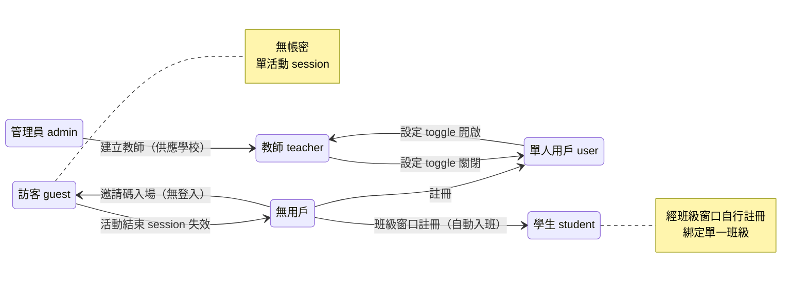

# 帳號與權限模型

> 日期：2026-11-20 ｜ 狀態：定稿（實作分階段落地，見 §10）
> 來源：Outline spec「角色與班級模型」rev 200（2026-11-17 定稿，G36maid 與 blade_isoe.520 共同討論）——本文件為 repo SSOT，Outline 僅留討論記錄。
> 本文件擁有「帳號與權限模型」domain：角色、模式、身分語意與設計決策。API 形狀與授權矩陣見 [`api-contract.md`](./api-contract.md)（§1.1、§2）；系統拓撲見 [`architecture.md`](./architecture.md)；SSO 流程見 [`google-oauth.md`](./google-oauth.md)。

## 1. 設計問答

**Q：訪客之後轉為正式使用者的窗口？**

老師不要批量生成帳號，而是提供建立帳號＋自動加入班級的窗口。

（課後討論拍板；文件 2026-11-20 收斂——「批量 email 建帳」「教師持有初始密碼」為舊稿殘留，已自 §5 user story、§6 角色表與狀態圖移除；窗口對應 main 的 `POST /auth/register`，帶班級碼註冊即入班。）

## 2. 抽象要求

- 使用者要可以同時是多個班級的學生
- 老師要可以管理多個班級
- 老師要可以自己開活動自己跑
- 訪客要可以不用登入就參與活動

## 3. user flows

- **新帳號註冊**：未登入狀態下從登入介面註冊；可以透過活動邀請窗口進入活動；可以透過教師的邀請進入班級，成為該班學生
- **臨時加入活動**：未登入狀態下存取活動邀請連結成為訪客；以訪客身分全程參與；活動結束後退回未登入狀態
- **使用者提權**：管理員將某位使用者的「班級與活動管理」權限打開；使用者可以新增班級、成為老師
- **教師自行測試**：教師在班級中創建活動並啟用「測試模式」——學生在班級裡看不見這個活動；教師能夠存取教師面板；教師能夠同時作為活動中的多位參與者進行多個平行的完整對話；結束時與正常活動流程一樣進入總結階段

## 4. 實體與術語分層

前提：這些詞分屬「帳號層」與「關係層」，混用會導致每個 endpoint 都要猜語意。

| 詞     | 所屬層級 | 在本模型的意義                                                                                        |
| ------ | -------- | ----------------------------------------------------------------------------------------------------- |
| 使用者 | 帳號層   | 一個帳號單位（`users`）                                                                               |
| 老師   | 關係層   | 班級的管理者（`classrooms.teacher_id`），不是帳號屬性；能否建班級由 `can_manage_classes` 決定（#131） |
| 學生   | 關係層   | 班級成員（`members`），可同時屬於多個班級                                                             |
| 訪客   | 活動層   | 不是帳號，是沒有 `user_id` 的活動參與者；活動關閉即消失（#133）                                       |
| 管理員 | 帳號層   | `is_admin`，透過 seed 建立（#131），只解鎖 `/admin/*`，不含建班級                                     |
| 班級   | —        | 一位老師、一組議題、一組成員                                                                          |
| 活動   | —        | 以一個議題為基礎、在一個班級內進行的一次對話，可為 live 或 test（#134）                               |
| 議題   | —        | 屬於一個班級，可複製到其他班級成為獨立副本（#135）                                                    |

同一帳號可以同時是 A 班老師、B 班學生；「誰參加了哪個活動」另由 `activity_participants` 承載（#132，契約見 api-contract §2.1）。

## 5. user stories

- 使用者可以是數個班級的教師：有權限的使用者可以新增／刪除班級；一個班級只由一個教師管理；教師送出加入班級的邀請碼與入班窗口——學生經窗口自行建立帳號，自動成為該班學生
- 班級擁有一系列議題：該班教師可以在網頁中新增或編輯議題；議題只從屬於一個班級，但教師可以把相同議題複製到其他班級
- 教師可以在班級中創建活動：活動必須基於一個議題；活動除了預設所有學生皆可參與之外，也須提供一次性邀請連結——未登入狀態下打開一次性邀請窗口，即會自動成為訪客；訪客不會列在該班級的名冊中，也不能存取班級的任何部分；訪客實體持續到活動關閉時消失；已登入狀態下打開一次性邀請窗口，不會加入班級，只會加入活動
- 處於未登入狀態時，要可以單獨註冊為使用者
- 管理員可以把使用者變為教師；管理員可以直接創建新的教師帳號；管理員可以直接創建新的使用者帳號；管理員可以注銷帳號

## 6. 角色與狀態

| 角色          | 產生方式                                           | 能力                                                      |
| ------------- | -------------------------------------------------- | --------------------------------------------------------- |
| admin 管理員  | —                                                  | 建立 teacher 帳號（供應帳號給學校）                       |
| user 單人用戶 | 註冊                                               | 加入多個班級與多個活動；與 teacher 以設定中的 toggle 互切 |
| teacher 教師  | admin 建立，或由 user 轉換（自行註冊後想開啟活動） | 開啟班級與活動；提供入班窗口                              |
| student 學生  | 班級窗口註冊（自行建立帳號），綁定該班級           | 班級內參與，跨活動累積紀錄與報告                          |
| guest 訪客    | 邀請碼入場，無登入                                 | 單一活動；活動級 session                                  |

## 7. 討論與拍板

**已討論（2026-11-17，spec rev 200）**

- 所有 teacher（含 admin 建立的供應帳號）都可與 user 互相切換
- student：經班級窗口自行建立帳號（教師不持有初始密碼），登入後綁定班級，紀錄與報告跨活動累積
- guest：活動級短 session，活動結束即失效，不留 email／密碼

**拍板（2026-11-20，#205）**

- user↔teacher 是**同一帳號的模式切換**（「目前進入教師模式或學生模式」），不是升降級；各自職責依舊存在——班級擁有權與資料不因切換消失，切回教師模式一切恢復
- 任何未停用帳號皆可**自行**翻轉（capability 自翻）：試用場景（自開自用）權責由該帳號自負（BYOK quota #146 承接已綁 key 的用量；keyless 自晉者的 platform pool 暴露面由 #115 容量設計處置）
- 學生模式下被擋的只有「進入教師工具」（建班、開活動、建議題）——`classroomAccess` 的擁有權判斷不受模式影響
- 與 #172（移除 trial 數量上限）同向：能力開放不設數量閘

## 8. 細節

- 活動邀請連結要有 QR code 的連結方式。

## 9. 目前不處理

- 不安全但容易事後修改，因此不處理：班級邀請碼（在仍稱作「教室」的時期）是六碼，是否複雜度過低？（原「帳號密碼都由老師處理是否不安全？」一項隨 §1 窗口拍板而消失，教師不再持有初始密碼）
- demo 階段不考慮的邊界：使用者帳號／老師帳號／班級刪除了要怎麼處理？一位學生同時間遇到兩個 live 活動怎麼辦？
- 按下不表的決策問題（決策前默認直覺、低成本選項）：班級是否允許多位老師？（目前一位）管理員是否可以讀取對話或報告？（目前不可）使用者要不要有單人模式？（目前不要——有建班權限的使用者可開「單人班級」並以測試模式實現）

## 10. 落地狀態

實作分階段進行；功能存在性清單的 SSOT 是 [`feature.md`](./feature.md)，此處只記模型落地：

- **已上 main**：capability 模型（`can_manage_classes`、admin 提權、停用斷 session，#131/#142）、班級邀請註冊（`POST /auth/register`）、訪客與 activity participants（#132/#133）、測試模式（#134）、自行註冊與 Google OAuth（#124）
- **review 中**：user↔teacher 模式 toggle（#208）
- **計畫中**：teacher 端建立 student（#206——原「批量建帳」範圍已被 §1 拍板推翻，窗口已在 main，待重劃或關閉）、SSO 擴充 Apple／Facebook 與 authProviders 探測（#207）
