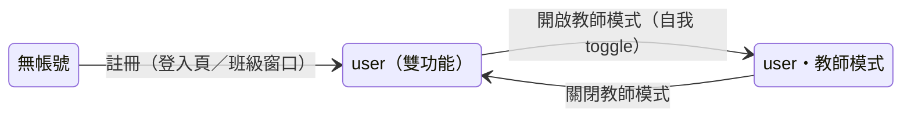
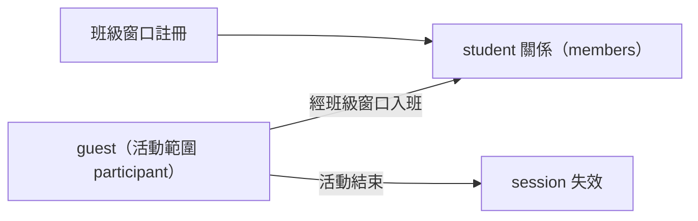

# 帳號與權限模型

> 日期：2026-11-20 ｜ 狀態：定稿（實作分階段落地，見 §10）
> 來源：Outline spec「角色與班級模型」rev 200（2026-11-17 定稿，G36maid 與 blade_isoe.520 共同討論）——本文件為 repo SSOT，Outline 僅留討論記錄。
> 本文件擁有「帳號與權限模型」domain：角色、模式、身分語意與設計決策。API 形狀與授權矩陣見 [`api-contract.md`](./api-contract.md)（§1.1、§2）；系統拓撲見 [`architecture.md`](./architecture.md)；SSO 流程見 [`google-oauth.md`](./google-oauth.md)。

## 1. 設計問答

**Q：訪客之後轉為正式使用者的窗口？**

老師不要批量生成帳號，而是提供建立帳號＋自動加入班級的窗口。

（課後討論拍板；文件 2026-11-20 收斂——「批量 email 建帳」「教師持有初始密碼」為舊稿殘留，已自 user story、角色表與狀態圖移除；窗口對應 main 的 `POST /auth/register`，帶班級碼註冊即入班。）

## 2. 抽象要求

- 使用者要可以同時是多個班級的學生
- 老師要可以管理多個班級
- 老師要可以自己開活動自己跑
- 訪客要可以不用登入就參與活動

## 3. user flows

- **新帳號註冊**：未登入狀態下從登入介面註冊；可以透過活動邀請窗口進入活動；可以透過教師的邀請進入班級，成為該班學生
- **臨時加入活動**：未登入狀態下存取活動邀請連結成為訪客；以訪客身分全程參與；活動結束後退回未登入狀態
- **訪客轉化**：訪客要成為班級學生，經班級窗口註冊（新帳號＋入班）——不經 admin；訪客紀錄認領合併已裁 NOT_PLANNED（#60，帳號設計重新討論的結果），無帳號訪客與新帳號之間不做紀錄連結；已登入者經邀請連結加入時 `kind='guest'` 且記下 `user_id`，帳號入班後該 participant 由 `ensureParticipant` 升級為 member（契約 §2.1）；教師模式是帳號的自我 toggle（#205）
- **教師自行測試**：教師在班級中創建活動並啟用「測試模式」——學生在班級裡看不見這個活動；教師能夠存取教師面板；教師能夠同時作為活動中的多位參與者進行多個平行的完整對話；結束時與正常活動流程一樣進入總結階段

## 4. 詞彙

| 詞      | 在本模型的意義                                                                                                         |
| ------- | ---------------------------------------------------------------------------------------------------------------------- |
| user    | 帳號（`users`）；模式為 student mode（預設）或 teacher mode，自我 toggle（#205）                                       |
| admin   | 管理帳號，`is_admin`，透過 seed 建立（#131）；只解鎖 `/admin/*`，不建班                                                |
| 模式    | user 的當前模式：**student mode**（預設）與 **teacher mode**（`can_manage_classes`，#131）；切換不動搖擁有權與資料     |
| teacher | 班級的 owner（`classrooms.teacher_id`）；建班與建活動需要 teacher mode，但擁有班級不要求隨時開著 mode                  |
| student | 班級成員（`members`），由班級窗口邀請產生；可同時屬於多個班級、參加該班所有活動                                        |
| guest   | 活動參與者，由邀請連結產生，僅活動級（#133）；無帳號（已登入者加入時記 `user_id` 僅作身分記錄）；活動結束 session 失效 |
| 班級    | 一位老師、一組議題、一組成員                                                                                           |
| 活動    | 以一個議題為基礎、在一個班級內進行的一次對話，可為 live 或 test（#134）                                                |
| 議題    | 屬於一個班級，可複製到其他班級成為獨立副本（#135）                                                                     |

同一帳號可以同時是 A 班老師、B 班學生；「誰參加了哪個活動」另由 `activity_participants` 承載（#132，契約見 api-contract §2.1）。

**帳號模型（Discord 式，2026-11-20 收斂）**：帳號只有 user（與管理用 admin）一種；user 只有 **teacher mode／student mode** 兩種模式（預設 student mode）；班級與活動皆由 teacher mode 建立；student 關係由邀請（班級窗口）產生、guest 由邀請連結產生且僅活動級——關係由加入產生，不由帳號種類決定。**廢除的說法**（帳號層與關係層混淆的殘留）：「純學生」「teacher 帳號」「student 帳號」——teacher 與 student 都是**關係**，承載它們的是同一種 user 帳號；「使用者提權」——推翻記錄見 §7。產品文案可繼續以「老師」「學生」直觀稱呼；本表約束的是模型與設計文件用語。

## 5. user stories

- 使用者可以是數個班級的教師：有權限的使用者可以新增／刪除班級；一個班級只由一個教師管理；教師送出加入班級的邀請碼與入班窗口——學生經窗口自行建立帳號，自動成為該班學生
- 班級擁有一系列議題：該班教師可以在網頁中新增或編輯議題；議題只從屬於一個班級，但教師可以把相同議題複製到其他班級
- 教師可以在班級中創建活動：活動必須基於一個議題；活動除了預設所有學生皆可參與之外，也須提供一次性邀請連結——未登入狀態下打開一次性邀請窗口，即會自動成為訪客；訪客不會列在該班級的名冊中，也不能存取班級的任何部分；訪客實體持續到活動關閉時消失；已登入狀態下打開一次性邀請窗口，不會加入班級，只會加入活動
- 處於未登入狀態時，要可以單獨註冊為使用者
- 管理員可以直接創建新的使用者帳號與教師供應帳號（建立時教師模式預設開啟——是「建立」而非「提權」）；管理員可以注銷帳號

## 6. 圖示（帳號與模式／進入與轉化）

帳號只有 user（註冊）與 admin（seed）兩種；teacher／student／guest 是關係與活動範圍的差異（§4），不是帳號狀態。

> admin 經 seed 建立、不入此圖；供應帳號由 admin 建立時教師模式預設開啟——是「建立」而非「提權」。

## 7. 討論與拍板

**已討論（2026-11-17，spec rev 200）**

- 所有 teacher（含 admin 建立的供應帳號）都可與 user 互相切換
- student：經班級窗口自行建立帳號（教師不持有初始密碼），登入後綁定班級，紀錄與報告跨活動累積
- guest：活動級短 session，活動結束即失效，不留 email／密碼

**拍板（2026-11-20，#205）**

- user↔teacher 是**同一帳號的模式切換**（「目前進入教師模式或學生模式」），不是升降級；各自職責依舊存在——班級擁有權與資料不因切換消失，切回教師模式一切恢復
- 任何未停用帳號皆可**自行**翻轉（capability 自翻）：試用場景（自開自用）權責由該帳號自負（BYOK quota #146 承接已綁 key 的用量；keyless 自晉者的 platform pool 暴露面由 #115 容量設計處置）
- 學生模式下被擋的只有「進入教師工具」（建班、開活動、建議題）——`classroomAccess` 的擁有權判斷不受模式影響
- 與 #172（移除 trial 數量上限）同向：能力開放不設數量閘
- **admin 提權推翻（2026-11-20）**：「使用者提權」（admin 授予 `can_manage_classes`）在 #131 模型中是取得能力的唯一路徑——admin 是成本閘門。#205 拍板 self-toggle 後它失去存在理由：授予冗餘（人人可自取）、降權不可執行（自翻即繞過）；原設計的成本防護由 #115 容量設計承接。admin 的桿子收斂為帳號層：建立帳號（含供應，教師模式預設開啟）與停用（`session_version` bump，session 立即失效——真實可執行）；`PATCH /admin/users/:id` 的 `canManageClasses` 欄位移除為待辦（§10）
- **帳號模型收斂為 Discord 式（2026-11-20）**：取消「純學生」概念——帳號只有 user，user 只有 teacher mode／student mode；班級與活動由 teacher mode 建立；student 關係由班級窗口邀請產生、guest 由邀請連結產生且僅活動級；login 即 user

## 8. 細節

- 活動邀請連結要有 QR code 的連結方式。

## 9. 目前不處理

- 不安全但容易事後修改，因此不處理：班級邀請碼（在仍稱作「教室」的時期）是六碼，是否複雜度過低？（原「帳號密碼都由老師處理是否不安全？」一項隨 §1 窗口拍板而消失，教師不再持有初始密碼）
- demo 階段不考慮的邊界：使用者帳號／老師帳號／班級刪除了要怎麼處理？一位學生同時間遇到兩個 live 活動怎麼辦？
- 按下不表的決策問題（決策前默認直覺、低成本選項）：班級是否允許多位老師？（目前一位）管理員是否可以讀取對話或報告？（目前不可）使用者要不要有單人模式？（目前不要——有建班權限的使用者可開「單人班級」並以測試模式實現）

## 10. 落地狀態

實作分階段進行；功能存在性清單的 SSOT 是 [`feature.md`](./feature.md)，此處只記模型落地：

- **已上 main**：capability 模型（`can_manage_classes`、admin 提權、停用斷 session，#131/#142）、班級邀請註冊（`POST /auth/register`）、訪客與 activity participants（#132/#133）、測試模式（#134）、自行註冊與 Google OAuth（#124）
- **review 中**：user↔teacher 模式 toggle（#208）
- **計畫中**：admin 提權端點退役（`PATCH /admin/users/:id` 移除 `canManageClasses` 欄位，§7 拍板）、SSO 擴充 Apple／Facebook 與 authProviders 探測（#207）；teacher 端建立 student（#206——原範圍已被窗口拍板推翻，待重劃或關閉）
