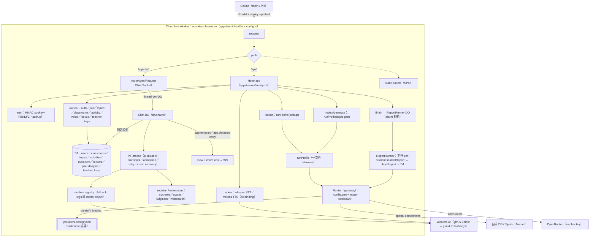

# 重構架構設計：socrates-classroom → Cloudflare + Pi Durable

> 日期：2026-11-03（§8/§13：2026-11-09）｜ 分支：`experiment/web-next`（PR #116）｜ 狀態：R0–R7 全數落地（R6 `hc<RpcApi>` 已接、R7 WS transport 已上）；剩實際部署（需 Cloudflare 帳號與 D1）
> 相關文件：[`cf.md`](./cf.md)（Cloudflare CLI）、[`pi.md`](./pi.md)（Pi Durable）、[`providers.md`](./providers.md)（provider 查證）、[`feature.md`](./feature.md)（功能總覽）

## 0. 已定決策（本文的約束條件）

| #   | 決策                                                                                             | 理由                                                                                     |
| --- | ------------------------------------------------------------------------------------------------ | ---------------------------------------------------------------------------------------- |
| D1  | 單一 Worker：Hono API + 前端 assets + Chat/ReportRunner DO 同包                                  | 部署單位最小、DO 不跨 Worker、`/api` 同源免 CORS                                         |
| D2  | App 資料放 **D1**；Pi transcript 留在 DO 自己的 SQLite（`pi_*` 表）                              | 共享關聯資料 vs agent 私有狀態，各放各的                                                 |
| D3  | 對話執行緒 = 一個 DO instance（`idFromName(scope:id)`）                                          | 天然序列化、互不干擾、Pi inbox 排隊                                                      |
| D4  | 對話走 WebSocket（`/agents/chat/:name`，view＋chord ops），SSE 已於 web-next 重建時退役          | 單一真相在 pi transcript；前端 applyImmutable 套件                                       |
| D5  | 全 Node 化（npm workspaces + vitest）；cf 指令走 Node ≥26.12                                     | `cf` 載 `cloudflare.config.ts` 不支援 Bun；Node 版本對齊 root AGENTS.md 與 CI（node 26） |
| D6  | Provider pool：自架(CF Tunnel) → opencode-go → OpenRouter → Workers AI，**全 ZDR、鎖模型白名單** | 學生資料不落地；Coding Plan 只開發用                                                     |
| D7  | Teacher keys：老師一 provider 一把 key（#82），學生無 BYOK 入口，byok 端點已退役                 | 學生流量一律走平台鏈，ZDR 責任單一                                                       |
| D8  | CI/CD：GitHub Actions 官方 cf 範本（build once → dry-run → `--prebuilt` deploy）                 | cf 無官方 action，純 steps 是欽定方式                                                    |

## 1. 系統拓撲



- TTS 保證路徑＝**server-side**（2026-11-04 決策）：預設 server-side，或 client `speechSynthesis` 先試、失敗/無 voice 時 fallback——#68 實作時定。原因：Firefox desktop 49+／Android 62+ 有 API（2026-11-04 查證 caniuse／MDN BCD）但 voices 全來自 OS、無 network voices——Linux 無 speech-dispatcher 時 `getVoices()` 為空、zh-TW voice 視 OS 而定，朗讀體驗不保證均一。server-side TTS candidate＝Workers AI（同 `AI` binding；model 的 ZDR／價格／zh-TW 待查證，見 providers.md 待辦）
- 圖為 v3 target view：uploads/R2（#87）、教室社群 posts/announcements/calendar/discussions（#85/#89）、題庫分享（#86）、四階段 debate（#84）、EmotionSplitter（#90）已依 v3 移除

非同步面：GitHub Actions 兩條 workflow（見 §8）；`cf previews deploy` 出 PR 預覽。

## 2. Monorepo 目錄樹

```
socrates-classroom/
├── apps/
│   ├── web/                        # 唯一 deployable：React SPA + cloudflare.config.ts（build 打包 server）
│   │   ├── src/
│   │   │   ├── api/                # hc<RpcApp> client（R6 型別共享）
│   │   │   ├── components/ hooks/ routes/ i18n/ lib/
│   │   │   └── main.tsx
│   │   └── package.json
│   └── server/                     # Worker source（pi-durable 架構）
│       ├── src/
│       │   ├── index.ts            # /api/* → Hono；/agents/* → routeAgentRequest（WS）
│       │   ├── app.ts              # createApp()：RpcApp 型別匯出（R6）
│       │   ├── routes/             # REST 端點（zod 驗證、fail() 錯誤契約）
│       │   ├── do/                 # 兩個 Durable Object
│       │   │   ├── chat.ts         # Chat：PiHarness + registry + models（thread 級）
│       │   │   └── report-runner.ts # ReportRunner：報告生成（activity 級，alarm 驅動）
│       │   ├── pi/                 # pi 整合層
│       │   │   ├── models.ts       # models registry 組裝（fallback legs 綁 model object）
│       │   │   ├── agents/profiles.ts  # agent profile（角色定義）+ runProfile 驅動
│       │   │   └── extensions/     # 行為載體：socrates／avatar／judgment／websearch
│       │   ├── gateway/            # provider 政策（gateway：config＋ledger＋router）
│       │   │   ├── gateway-schema.ts   # zod schema（YAML 的型別）
│       │   │   ├── config.gen.ts       # build-time 產出（scripts/gen-config.mjs）
│       │   │   ├── ledger.ts           # (provider, model, credential) 記帳＋cooldown
│       │   │   └── router.ts           # traffic class 鏈走訪（teacher legs 前置合併）
│       │   ├── prompts/            # LLM 組的 prompt 資產（build-time ?raw）
│       │   │   ├── socrates.md / class-report.md / student-report.md
│       │   ├── ws/                 # transport glue（protocol + sockets）
│       │   ├── auth.ts / auth-crypto.ts  # session＋AES-GCM（byok.ts 併入）
│       │   ├── db/d1.ts / http.ts / messages.ts / seed.ts / services/
│       │   └── env.ts
│       ├── providers.config.yaml   # 唯一配置點（provider×credential×priority×classifiers）
│       ├── migrations/             # D1 SQL
│       └── scripts/gen-config.mjs  # YAML → config.gen.ts
├── packages/
│   └── shared/                     # API 契約：zod schemas + ErrorCode + Lang + 報告分析
├── .github/workflows/{ci,deploy}.yml
├── pnpm-workspace.yaml             # apps/* packages/*
└── docs/                           # SSOT：architecture（本文）/ api-contract / pi / providers / feature / roadmap / changelog
```

> `packages/llm` 已解散（2026-11-06）：prompts 併入 `apps/server/src/prompts/`，models.json 併入 `providers.config.yaml`——一個 package 養 4 個檔案不成立，且唯一的消費者是 server。LLM 組的編輯點就是這兩處。

## 3. Worker 分層（apps/server）

**組裝**：`createApp()`（Hono，`app.ts`）——bindings = D1、AI、vars/secrets（`env.ts`）。prompt 與 provider 配置全走 build-time（`src/prompts/*.md?raw`、`providers.config.yaml` → `gateway/config.gen.ts`）。

**Worker 入口（index.ts）**：`/api/*` → Hono；`/agents/*` → `routeAgentRequest`（WebSocket）；其餘 → static assets。

**Db 介面（db/d1.ts）**：

```ts
export interface Db {
  one<T>(sql: string, params?: Record<string, unknown>): Promise<T | null>;
  all<T>(sql: string, params?: Record<string, unknown>): Promise<T[]>;
  run(sql: string, params?: Record<string, unknown>): Promise<void>;
  batch(sqls: Array<[string, Record<string, unknown>?]>): Promise<void>; // 取代 tx()
}
```

- SQL 字串與 `$named` 參數原樣保留（D1 就是 SQLite）；所有呼叫點加 `await`（Hono handler 本來就是 async）
- 現 12 處 `tx(db, () => {…})` 是「先讀後寫」的小交易 → 改寫成「先讀、`batch([INSERT,INSERT,UPDATE])` 原子寫」。讀寫之間無外部依賴，語意等價；若未來需要真互動式交易，再評估 DO SQLite
- `_migrations` 表退役 → `cf d1 migrations apply <DB_ID> --dir apps/server/migrations`（CI 執行）

**CORS**：同源部署，production 無 middleware（v3 的 CORS_ORIGINS 已退役）。

## 4. Durable Objects（apps/server/src/do/）

兩個 DO，職責分離：

### Chat（do/chat.ts）——thread 級

一個對話執行緒一個 instance（`/agents/chat/:name`）。內部組成：

- `PiHarness`＋`Lifecycle`：pi-durable 的宿主（transcript／admission／retry／crash recovery 全在 pi，見 docs/pi.md）
- `registry`（per-object field，官方要求）：裝四個 extensions（socrates／avatar／judgment／websearch）——行為的唯一載體
- `models registry`：fallback legs 綁在 model object 上（symbol 機制，docs/pi.md §Fallback legs）
- `ws/sockets.ts`：transport glue——watch(view+chord ops)／submit(whenBusy: reject)／entries；onStart reattach

no queue：busy 時第二發被拒（`ConversationBusy` → error frame），不排隊（#110 設計決定）。

### ReportRunner（do/report-runner.ts）——activity 級

`finish` 觸發，alarm 驅動（crash-safe，attempts 上限 3）：

```
startReport → pending 標記 → alarm → generate：
  transcriptOf（AI：…/學生（n）：… 編號＋假名冪等）
  → Promise.all 平行 per-student studentReport（重試 2）
  → classReport（立場軸/落點/分群）
  → persist（D1 reports：teacher_report=classReport、student_reports=analysis+violations-from-transcript）
```

模型呼叫經 `runProfile("report-analyst")`（一次性 Harness，MemoryStorage）——落點不重算（classReport 為準）、違規切片從 pi transcript 抽取（`/transcript` 端點，不落第二份儲存）。

## 5. Gateway（apps/server/src/gateway/）

provider 政策層（v3 的 ProviderPool/whitelist 退役）。**單一配置點**：`providers.config.yaml`（build-time 編譯成 zod 驗證的 `config.gen.ts`）。

| 檔案                | 職責                                                                                                                                      |
| ------------------- | ----------------------------------------------------------------------------------------------------------------------------------------- |
| `gateway-schema.ts` | YAML 的 zod schema：provider 實例（endpoint+model）×credential 分離；classifiers；availability（priority/maxConcurrency）；trafficClasses |
| `config.gen.ts`     | `scripts/gen-config.mjs` 產出（Workers 無檔案系統）                                                                                       |
| `ledger.ts`         | (provider, model, credential) 記帳＋cooldown（pi 無結構化錯誤狀態→只記 ok/error；連續 5 error 開 60s、ok 重置、過期自然回無 probe）       |
| `router.ts`         | traffic class 鏈走訪（priority 排序＋cooldown/maxConcurrency 過濾、teacher legs 前置）→ pick；isolate 生命週期（getRouter WeakMap）       |


**請求層 vs 決策層**：fallback legs 的試錯、retry 退避由 pi 原生（`streamWithFallback`／`settings.retry`）；gateway 只決定「誰該拿到哪條 legs、誰的錢、記誰的帳」。調查過 LiteLLM Router／pi-router／pi-fallback-provider（#98 留言，2026-11-06）——結論：不引入，pi 原生＋三個小件已涵蓋。

**credential**：`platform`（env）／`teacher:{user_id}`（D1 `teacher_keys`，一 provider 一把 key，AES-GCM）。學生無 BYOK（#82 定案）。teacher key 設定頁是前端配套（#82）。

**traffic class**：interactive（對話/lookup）／judgment（分類）／batch（報告/生成）——agent profile 只寫角色，model 全由這裡解析（#113）。

**ZDR 規則**：provider 的准入（0-day retention）由 `providers.config.yaml` 的 providers 節把關——加 provider 前讀 `docs/providers.md`。判斷模型（Clef）走 Workers AI binding（ZDR 官方明文，#55）。

## 6. 資料層

- **D1 schema**：users／classrooms／topics／activities／members／reports／pseudonyms／teacher_keys（`migrations/001-003`）。`messages`／`violations` 死表已於 003 退役——pi transcript 是對話與違規的唯一真相
- **teacher_keys**：`teacher_keys(user_id, provider_id)` 一對一（AES-GCM，金鑰為 Worker secret `BYOK_ENC_KEY`），`sort_order` 為 gateway 的 provider 鏈序（#82）
- **DO SQLite**：只有 pi 自己的 `pi_*` 表，應用程式不讀寫——agent 狀態與產品資料分離（D2）
- **保留政策**：AI Gateway log/cache 關閉；Worker 觀測 log 不含 prompt 內容（judgment sink 只記 type/source）

## 7. 型別共享（packages/shared + Hono RPC）

```
apps/server/src/app.ts  export type RpcApp = ReturnType<typeof createApp>
apps/web/src/api        import { hc } from "hono/client"; hc<RpcApp>("/api")
```

- 契約形狀（zod schema、ErrorCode、Lang、報告分析）在 `packages/shared`——server 與 web 共享的可編譯真相
- mock 模式：`LLM_PROVIDER=mock`（server 端 faux provider）；web 端的手寫 mock 已隨 v3 退役

## 8. CI/CD（.github/workflows）

```yaml
# ci.yml（PR + push main）：全部閘門，不需要 secrets
- uses: pnpm/action-setup + actions/setup-node@v6 (node 26, cache pnpm)
- run: pnpm install --frozen-lockfile
- run: pnpm lint # biome
- run: yamllint . # workflows / pnpm-workspace（版本鎖 yamllint==1.38.0）
- run: pnpm --filter @socrates/server run gen-config && git diff --exit-code # config.gen 漂移檢查
- run: pnpm typecheck # server build:types → web tsc（RpcApi 宣告先產出）
- run: pnpm test # pnpm -r test：server（workerd 真runtime，hookTimeout 120s）+ web
- run: pnpm exec cf build # apps/web：client assets + worker bundle
- run: pnpm exec cf deploy --prebuilt --mode production --dry-run

# deploy.yml（push main）：同一產物部署
- run: pnpm exec cf build
- run: pnpm exec cf d1 migrations apply $D1_DATABASE_ID --dir ../server/migrations
- run: pnpm exec cf deploy --prebuilt --mode production # 唯一拿 secrets 的 step
```

- secrets：`CLOUDFLARE_API_TOKEN`、`CLOUDFLARE_ACCOUNT_ID`、`D1_DATABASE_ID`；runtime secrets 走 `cf deploy` 環境注入（`AUTH_SECRET`、`BYOK_ENC_KEY`、`DGX_BASE_URL` 等，見 `apps/web/.env.example`）
- **D1 migration 重置決策（2026-11-08）**：從未部署過（所有 deploy run 都在 migration step 因缺 `D1_DATABASE_ID` 失敗），`001_init.sql` 原地重寫為 v4 schema（10 表）——不做前向 migration。本地若殘留 v3 D1：刪掉 `.cloudflare/state`（或對應 persist 目錄）重來即可；`d1_migrations` 狀態與新 001 不相容是預期行為
- wrangler 僅存於 devDependencies（cf 的建置後端 + `wrangler tail`）

## 9. 測試策略（vitest-pool-workers）

| 檔案                        | 內容                                                                              |
| --------------------------- | --------------------------------------------------------------------------------- |
| `tests/chat.test.ts`        | 主流程（WS 升級→hello→watch→submit→回答）、evict 重連恢復、ConversationBusy       |
| `tests/avatar.test.ts`      | 情緒 entry 形狀、文字零污染                                                       |
| `tests/judgment.test.ts`    | tool 註冊、agent 自報 entry                                                       |
| `tests/websearch.test.ts`   | 三 tool 註冊、SSRF 矩陣、cache、store/find/slice                                  |
| `tests/profiles.test.ts`    | profile 表零 model hardcode、真 prompt 資產接線、runProfile 全路徑                |
| `tests/gateway.test.ts`     | cooldown 語意矩陣、config 形狀、分開記帳                                          |
| `tests/rest.test.ts`        | 真 Worker 入口：seed guard/ToS join/歷史/finish→report/授權矩陣/teacher keys CRUD |
| `tests/report.test.ts`      | 報告管線端到端：ready/partial 形狀（§7）、pseudonym integrity、IDOR               |
| `tests/auth-crypto.test.ts` | AES-GCM/HKDF 加密、版本前綴、timing-safe 比對                                     |
| `tests/d1.test.ts`          | `$named` 轉 positional——字串常數內 `$` 不替換                                     |
| `tests/helpers.ts`          | 共享 WS 測試原語：frames/latestView/assistantText                                 |

原則：真 DO＋真 WebSocket＋faux model（無 fetch 攔截、無 mock DO）；斷言只驗形狀不驗內容。web 端另有 vitest（jsdom）＋review overlay。

## 10. 實作歷程（v3 → 現況）

| 里程碑                                  | 內容                                                                                                                                                         |
| --------------------------------------- | ------------------------------------------------------------------------------------------------------------------------------------------------------------ |
| R0–R5（v3）                             | monorepo、D1 介面、PiAgent DO、provider pool——已被 web-next 重建取代                                                                                         |
| web-next 重建（2026-11-06）             | 兩大原則重構：Chat DO＋PiHarness、extensions（avatar/judgment/websearch）、agent profiles、gateway（YAML＋ledger）、ReportRunner、teacher_keys、WS transport |
| R6/R7 收尾（2026-11-08）                | `hc<RpcApi>` 全面接上（web types.ts 退役）；WS transport 上線（watch resume、逐訊授權閘門）                                                                  |
| prompt 接線＋teacher keys（2026-11-09） | profiles instructions 接真資產（§7 報告可生產）；teacher keys 服務（ToS 責任移轉、老師鏈前平台鏈後）                                                         |

## 11. ADR 摘要

- **單 Worker**（D1）：對課堂規模，部署與心智負擔最小化優先於微服務彈性
- **D1 vs DO SQLite**（D2）：D1 有 SQL 檔遷移、查詢分析、跨 DO 共享；pi 私有狀態本來就自帶 schema 管理
- **WS 直上**（D4）：SSE adapter 於 web-next 重建時退役——pi transcript 是唯一真相，view＋chord ops 的快照恢復（斷線重連）原生免實作
- **鎖模型而非鎖 provider**（D6）：ZDR 是模型級承諾（opencode-go 表內混有 30 天/會訓練的模型）
- **Teacher keys 加密**（D7）：`BYOK_ENC_KEY` AES-GCM；key 永不進 log、永不回前端明文；學生無 BYOK 入口（#82 定案）

## 12. 風險與對策

| 風險                                                        | 對策                                                                                                |
| ----------------------------------------------------------- | --------------------------------------------------------------------------------------------------- |
| D1 無互動式交易，tx→batch 語意差異                          | R1 逐處改寫 + 快照測試；複雜案例再評估 DO SQLite                                                    |
| cf beta 格式變動                                            | `cf` 鎖 devDependency；`cloudflare.config.ts` 變更走 CI dry-run 先擋                                |
| 自架 Tunnel 延遲                                            | 爆發期實測 P95；不行就把自架降為「教室內網直連 + 雲端走 opencode-go/OpenRouter」                    |
| opencode-go 條款灰域                                        | 上線前 email 官方；未確認前它不是唯一依賴（有 OpenRouter/Workers AI 兜底）                          |
| Pi 限制（15 分鐘 alarm、無 approval、event 無 cursor）      | 回覆 ≤3 句不受影響；工具白名單先不開寫入類                                                          |
| module 級狀態（rate-limit 的 Map）隨 isolate 分散且重啟歸零 | 定位為 best-effort；跨請求一致的併發守衛在 Chat DO 的 whenBusy reject。多 isolate 佈局後限流改走 DO |

## 13. Scale design v2（D9–D13）——10k 併發作為 code quality bar

> 狀態：規劃中（`experiment/web-next`，2026-11-04）。設計容量 10,000 條 concurrent 對話 thread，作為 code quality bar（非流量預期）：horizontal scaling 是 Cloudflare 的責任，自建 bottleneck 是本 repo 的責任。任何 hot path 必須屬於三型之一——(a) stateless-horizontal：任何 isolate 皆可執行；(b) DO-sharded：狀態鎖進單執行緒單元；(c) queue-buffered：寫入以 batch 吸收。平台事實（D1 single-writer throughput、Queues limits、DO streaming 無時限）已於 2026-11-04 對官方文件查證。

### 13.0 負載模型（axiom）

| 項目                                     | steady state              | class-start burst（~30s） |
| ---------------------------------------- | ------------------------- | ------------------------- |
| concurrent 對話 thread                   | 10,000（~250 班 × 40 人） | —                         |
| generation plane（對話輪/秒）            | ~220                      | ~1,000                    |
| judgment plane（choice/秒）              | ~220                      | ~1,000                    |
| STT（音檔/秒）                           | ~220                      | ~1,000                    |
| WS 連線（學生對話＋教師觀察）            | ~10,400                   | —                         |
| 原始寫入（輪＋violation＋event＋ledger） | ~700/s                    | ~3,000/s                  |
| 讀取（auth／面板／歷史）                 | ~5,000/s                  | —                         |

第一個 structural bottleneck：同步寫 D1 在 ~300 writes/s 觸頂（D1 是 single-writer、每筆寫入數 ms；官方 throughput 公式＝1/query duration，`batch()` 是官方逃生口）→ 對策見 D12。

### 13.1 D9 judgment plane（one-shot gateway）

v3 的班級層產出——即時面板標記（#73）、單人報告（#74/#78）、群體立場星圖（#79）、認真度——全部是 judgment plane 對 transcripts 的加工。generation plane 採集，judgment plane 加工；教學目標（C1/C2/S1/S2/A1/A2）的 proxy indicators 全部由 judgment 層量測。

- gateway＝**stateless function**（isolate 內直呼，不經 DO）：輸入＝transcript 片段＋prompt 題型；輸出＝structured choice／評分。題型：逐輪 violation choice（#71）、intent 分類（#76）、report 分析（#74）、表情 choice（#90 之後）
- 逐輪 judgment 走 async：turn commit → enqueue（D10）→ judgment → violations 批次寫入 → publish 到 event layer → 面板；latency budget ≤30s，不擋對話主迴圈
- judgment 模型也進 router catalog（#55 已拍板：Clef-flash 主力、Clef 備選；Jev 不採用——ZDR 未過、自架 DGX 出局——容量）：Workers AI 的 daily quota 在 220 rps 下數小時耗盡——judgment 與 generation 共用 D11 的 multi-provider routing（不同 traffic class，D11 保留慣用語）
- 模型可替換（#55 既定）：題型 schema 放 shared，模型是 catalog 一行設定

### 13.2 D10 background jobs plane（Queues + Workflows）

- event stream（turn done／violation／usage）→ **Workers Queues**（每 queue 5,000 msg/s、consumer concurrency 至 250、batch 100、15 分鐘執行時限、DLQ）→ consumer 以 `batch()` 寫 D1——700 writes/s 收斂為 <10 batch requests/s
- 報告生成（#74）→ **CF Workflows** 編排：activity finish → fan-out 單人分析（經 Queues parallel）→ aggregate（立場軸/落點/分群）→ 寫 D1 → 通知。50 生 parallel ≈ <2 分鐘，滿足 #74「幾分鐘內可讀」
- 訊息不可丟：DLQ＋retention replay；consumer 必須 idempotent（以 turn id 去重）

### 13.3 D11 gateway plane（parallel multi-provider，取代 §5 的 fallback chain）

- **catalog（資料，非程式）**：每個 provider 一份 descriptor——quota model（concurrency／sliding window／RPM／balance／neurons）、成本、ZDR、traffic class、affinity 提示
- **parallel multi-provider**：所有 healthy 且有餘量的 provider 同時參與 scoring 收新 thread；系統 throughput＝各 provider capacity 之和，不是 chain head 的 max。assignment 偏好：cost-first＋免費容量保留 burst buffer
- **Coordinator DO**（每 provider／每 BYOK namespace 一個 instance）：全域 concurrency gate＋usage ledger＋affinity map＋circuit breaker（closed/open/half-open）。acquire/release 是 in-memory 操作＋input gate batching，單 DO 可達數千 rps（D1 本身即以 DO 建成，為 throughput 量級佐證）
- **affinity（thread 級）**：thread 誕生時 scoring 一次、落點 cache 在 Chat DO storage——per-turn 零 coordinator 讀取；affinity map 記 `home／current／since`。opencode 的 `x-opencode-session` 以 per-thread header 注入（providers.md 客戶端要求）
- **failover 階梯**：transient error（單輪 429/timeout）→ 該輪 failover 到別廠、home 不變；hard failure（breaker open）→ 該 thread reassign＋home 改寫＋provider 自 scoring pool evict。**failback＝re-admission，不 recall 既有 thread**（不打斷 prompt cache／語氣連續，避免 flapping），並加 recovery 觀察窗
- **usage ledger**：每輪一筆 Analytics Engine data point（provider／tokens／latency／outcome／class），cron 彙總寫 D1 rollup——#80 面板、#81 警示、#63 停損 kill-switch 的同源資料；kill-switch 是 router 的 enforcement point（額度見底→該 namespace score 歸零）
- **BYOK namespace**（#82：老師／單人）：namespace＝key 擁有者。老師 key 承載全班＝單一 quota ledger 被全班 thread 併發計量——全域計量是必要條件

### 13.4 D12 data tiering

| tier | 內容                       | 規則                                                                                          |
| ---- | -------------------------- | --------------------------------------------------------------------------------------------- |
| L0   | transcript source of truth | DO SQLite（`pi_*`，D2 既有決策的強化）：**generation plane 零同步 D1 寫入**                   |
| L1   | event stream projection    | Queues → `batch()` 寫 D1（dialogue projection／violations／usage 明細）                       |
| L2   | product tables             | users／classrooms／topics／activities 低頻寫入；讀取走 read replication（Sessions API）       |
| L3   | auth                       | signed cookie（HMAC＋短 TTL）——hot path 零 DB 讀；revocation 表僅敏感操作查（#67 重寫時落地） |

成長逃生口（現不做）：D1 per-shard sharding（付費帳號可開百萬級 DB，平台鼓勵的 multi-tenant 模式）。寫入 tiering 後 10k 僅需 <50 writes/s 進 D1。

### 13.5 D13 event layer

v3 設計為 ActivityEvents DO（SSE-in-DO＋ring buffer＋Last-Event-ID replay）；**已隨 web-next 退役**（SSE 對話改 Chat DO 的 WS hibernation，見 §4）。老師即時面板的資料源改道：#73 調查選擇輪詢 SQL 聚合（待拍板），無獨立 event DO。

### 13.6 與 v3 實作的 gap（2026-11-06 web-next 重建後的狀態）

| #   | 變更                                           | 狀態                                                       |
| --- | ---------------------------------------------- | ---------------------------------------------------------- |
| 1   | signed cookie 取代 sessions 表 hot read        | ✅ 已做（auth.ts）                                         |
| 2   | dialogue-save 同步寫 → Queues projection       | 未做（現為同步 batch，10k 前可接受）                       |
| 3   | violations／usage event stream → Queues＋batch | 未做（judgment 走 entry＋D1）                              |
| 4   | 報告生成 → Workflows 編排                      | 部分：ReportRunner DO alarm（crash-safe）；Workflows 待評  |
| 5   | ActivityEvents → WS hibernation＋ring buffer   | 改道：#73 調查選輪詢 SQL 聚合（待拍板）；ring buffer 退役  |
| 6   | pool.ts → gateway（config／ledger／cooldown）  | ✅ 已做（§5）；Coordinator DO 未建（ledger 在 isolate 內） |
| 7   | agents 0.33＋pi 1.5                            | ✅ 已做                                                    |
| 8   | AE data point＋cron rollup                     | 未做（#80/#81/#63，本輪不做）                              |

新 bindings（ask-first）：Queues、Workflows、Rate Limiting（#103）、Analytics Engine。

### 13.7 Honest limits（設計不假裝解決的）

1. **Provider 經濟**：220 rps × ~1.5k token ≈ 330k token/s，滿載 ~$120–360/小時（GLM flash 級）。router 只提供商業開關（namespace／kill-switch／traffic class），誰付錢是 #62 的產品決策
2. **Workers AI judgment quota**：Clef 免費 daily quota 數小時耗盡——judgment plane 必須 multi-provider
3. **單一 D1**：tiering 後 10k 可達；真到百萬級 OLTP 需求 → sharding 逃生口
4. **單 Worker＝全體同時換版**：部署走 Gradual Deployments＋expand-contract migrations
