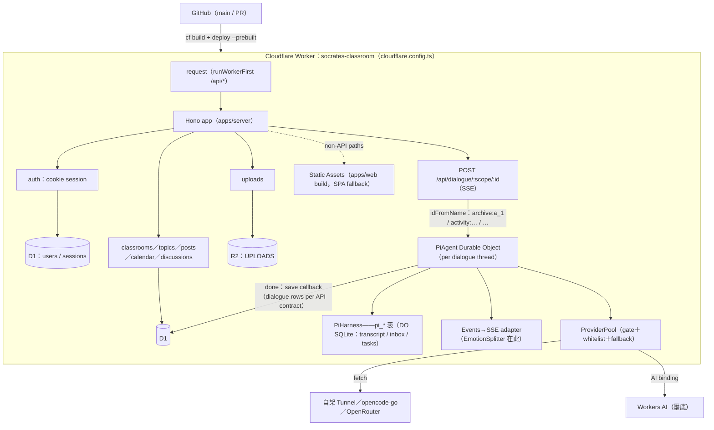

# 重構架構設計：socrates-classroom → Cloudflare + Pi Durable

> 日期：2026-11 ｜ 分支：`refactor/cf-pi-durable` ｜ 狀態：**R0–R5 已實作、R6 僅完成 shared 型別（`hc<RpcApp>` web 端改寫未做）**——測試全綠；剩 R3 實際部署（需 Cloudflare 帳號）與 R7 WebSocket（Phase 3）｜ **§13 v2 規模設計（D9–D13）：規劃中（`experiment/web-next`）**
> 相關文件：[`cf.md`](./cf.md)（Cloudflare CLI）、[`pi.md`](./pi.md)（Pi Durable）、[`providers.md`](./providers.md)（provider 查證）、[`feature.md`](./feature.md)（功能總覽）

## 0. 已定決策（本文的約束條件）

| #   | 決策                                                                                             | 理由                                                           |
| --- | ------------------------------------------------------------------------------------------------ | -------------------------------------------------------------- |
| D1  | 單一 Worker：Hono API + 前端 assets + PiAgent DO 同包                                            | 部署單位最小、DO 不跨 Worker、`/api` 同源免 CORS               |
| D2  | App 資料放 **D1**；Pi transcript 留在 DO 自己的 SQLite（`pi_*` 表）                              | 共享關聯資料 vs agent 私有狀態，各放各的                       |
| D3  | 對話執行緒 = 一個 DO instance（`idFromName(scope:id)`）                                          | 天然序列化、互不干擾、Pi inbox 排隊                            |
| D4  | 前端契約不變：DO 內把 `session.events()` 轉回現有 SSE（`delta/emotion/done/error`）              | 前端零改動上線；WebSocket + steer 列 Phase 3                   |
| D5  | 全 Node 化（npm workspaces + vitest）；cf 指令走 Node ≥22.23                                     | `cf` 載 `cloudflare.config.ts` 不支援 Bun；server 已無 Bun API |
| D6  | Provider pool：自架(CF Tunnel) → opencode-go → OpenRouter → Workers AI，**全 ZDR、鎖模型白名單** | 學生資料不落地；Coding Plan 只開發用                           |
| D7  | 產品級 BYOK：學生可填自己的 OpenRouter key（加密存 D1，強制 `zdr`）                              | 一人一帳號，共享條款問題消失                                   |
| D8  | CI/CD：GitHub Actions 官方 cf 範本（build once → dry-run → `--prebuilt` deploy）                 | cf 無官方 action，純 steps 是欽定方式                          |

## 1. 系統拓撲



非同步面：GitHub Actions 兩條 workflow（見 §8）；`cf previews deploy` 出 PR 預覽。

## 2. Monorepo 目錄樹

```
socrates-classroom/
├── apps/
│   ├── web/                        # ← 現 frontend/（React + Vite）
│   │   ├── src/
│   │   │   ├── api/                # 改用 packages/shared 的 hc<RpcApp> client（mock 模式保留）
│   │   │   ├── lib/ pages/ i18n/
│   │   │   └── main.tsx
│   │   ├── vite.config.ts
│   │   └── package.json
│   └── server/                     # ← 現 server/（Hono）＋ 新增 DO 與 pool
│       ├── src/
│       │   ├── index.ts            # export default { fetch: app.fetch } + export { PiAgent }
│       │   ├── app.ts              # createApp(bindings): RpcApp（型別匯出給 shared/web）
│       │   ├── routes/             # 現有路由，簽名改 async + bindings 注入
│       │   ├── services/           # activities/debate/…（改 D1 Db 介面）
│       │   │   └── dialogue.ts     # 退役 → 邏輯移入 DO 的 SSE adapter
│       │   ├── db/
│       │   │   ├── d1.ts           # Db 介面 + D1 實作（one/all/run/batch）
│       │   │   └── tx.ts           # 現 tx(db,fn) 12 處 → batch() 語意改寫
│       │   ├── do/
│       │   │   └── pi-agent.ts     # PiAgent：PiHarness + SSE adapter + save
│       │   └── providers/
│       │       ├── pool.ts         # 白名單、fallback 鏈、gate
│       │       ├── whitelist.ts    # ZDR 0-day 模型清單（唯一可路由集）
│       │       └── byok.ts         # 學生 key 加解密（AES-GCM）+ 路由
│       ├── migrations/             # 現 SQL 原樣 → cf d1 migrations apply
│       ├── cloudflare.config.ts    # worker + assets + D1 + R2 + AI + DO exports
│       └── package.json
├── packages/
│   ├── shared/                     # API 契約：zod schemas + Emotion/Lang 型別 + App 型別重匯出
│   │   └── src/{schema.ts, rpc.ts}
│   └── llm/                        # ← 現 llm/（zero-code 精神不變）
│       ├── prompts/socrates.md     # build-time ?raw 進 DO 的 registry section
│       └── providers/models.json   # 決策來源；pool.ts 編譯期 import 此檔的鏡像常數
├── .github/workflows/{ci,deploy}.yml
├── package.json                    # npm workspaces: apps/* packages/*
└── docs/                           # architecture（本文）/ providers / feature / cf / pi
```

## 3. Worker 分層（apps/server）

**組裝（相依注入）**：`createApp(bindings)` 取代 `createApp(db, config)`。bindings = D1、R2、AI、PiAgent namespace、vars/secrets。舊 `config.ts` 的 fs 讀檔全部轉 build-time import（`packages/llm/prompts/socrates.md?raw`、providers 常數），env 值走 `bindings.vars`。

**Db 介面（db/d1.ts）**：

```ts
export interface Db {
  one<T>(sql: string, params?: Record<string, unknown>): Promise<T | null>;
  all<T>(sql: string, params?: Record<string, unknown>): Promise<T[]>;
  run(sql: string, params?: Record<string, unknown>): Promise<void>;
  batch(sqls: Array<[string, Record<string, unknown>?]>): Promise<void>; // 取代 tx()
}
```

- SQL 字串與 `$named` 參數原樣保留（D1 就是 SQLite）；所有呼叫點加 `await`（Hono handler 本來就是 async）
- 現 12 處 `tx(db, () => {…})` 是「先讀後寫」的小交易 → 改寫成「先讀、`batch([INSERT,INSERT,UPDATE])` 原子寫」。讀寫之間無外部依賴，語意等價；若未來需要真互動式交易，再評估 DO SQLite
- `_migrations` 表退役 → `cf d1 migrations apply <DB_ID> --dir apps/server/migrations`（CI 執行）

**上傳（services/files.ts）**：`Bun.write/Bun.file` → `bindings.UPLOADS.put(id, file.stream())` / `.get(id)`；`files.path` 欄位改存 R2 key（migration 加一欄或沿用 path 存 key）。

**CORS**：同源部署後僅 dev 需要（Vite proxy），production 分支直接跳過 middleware。

## 4. PiAgent Durable Object（apps/server/src/do/pi-agent.ts）

**職責**：一個對話執行緒的 agent 狀態機。對外三個方法（RPC）：

```ts
export class PiAgent extends DurableObject<Env> {
  // 回 SSE Response；內部把 pi events 轉成現有 delta/emotion/done/error 契約
  dialogue(input: DialogueInput): Promise<Response>;
  // Phase 3：WebSocket + outbox 版（官方 harnesses 玩法）
  socket(): Promise<Response>;
  // 管理用：目前 pool 狀態、pending 佇列
  status(): Promise<PoolStatus>;
}
```

**dialogue() 內部流程**：

```
1. session = harness.session()            # root session；pi transcript 在 DO SQLite
2. events  = await session.events()       # snapshot（含 mid-turn partial）
3. receipt = session.submit(userText, { operationId: messageId })
4. ReadableStream：
     events.start(batch => {
       for (event of batch)
         piece = emotionSplitter.push(mapEvent(event))   # 現 EmotionSplitter 原樣沿用
         send("delta"/"emotion", …)
     })
     完成後：acc = 純文字；emotion = 首個標記
5. save：db.batch([INSERT user msg, INSERT assistant msg, UPDATE rounds/snippet])
6. send("done", { message })；收尾 ping/cleanup（沿用現 dialogueSse 骨架）
7. 錯誤：PiError → 對應 429/503 + key（llm_rate_limited 等契約不變）；SSE 開始後才錯 → event:error
```

- **學生追問**：對話進行中再 submit → pi inbox 排隊（follow-up）；Phase 3 改 `steer()` 插話
- **歷史**：Pi transcript 是 agent 的工作記憶；D1 仍是產品資料（對話存檔、討論區瀏覽、計分）。重置對話 = `session.reset(handoff)` + D1 開新 archive
- **prompt**：`registry.install({ sections: [{ render: () => PREAMBLE }] })`，PREAMBLE 來自 `packages/llm/prompts/socrates.md` 的 build-time import——LLM 組改檔 → 重新部署即生效
- **鎖與限流**：`dialogue.ts` 的 in-memory lock/rate Map 退役——DO 單執行緒即鎖；每人 20 req/min 移到 Hono 層（D1 或 DO 計數）；併發閘在 pool（§5）

## 5. Provider Pool（providers/pool.ts）

**白名單（唯一可路由集，全 ZDR 0-day）**：

| 順位 | provider               | model id                    | gate                       | 備註                                                          |
| ---- | ---------------------- | --------------------------- | -------------------------- | ------------------------------------------------------------- |
| 1    | dgx-spark（CF Tunnel） | `GLM-5.3-Flash-EXL3`        | 併發 4                     | compat：`maxTokensField:max_tokens`、無 developer role        |
| 2    | opencode-go            | `glm-5.3-flash`             | 429 驅動                   | UA `socrates-classroom/1.0` + `x-opencode-session:{threadId}` |
| 3    | openrouter             | `z-ai/glm-5.3-flash`        | `zdr:true` 強制            | 班級 key；$0.0285/$0.0923                                     |
| 4    | workers-ai             | `@cf/zai-org/glm-4.7-flash` | 50 req/min（預付 credits） | `AI` binding，免 key                                          |

**實作**：pi-ai 的 Models registry 支援 fallback 陣列（首選失敗自動下一個）——pool = 白名單依序組成的 fallback list + 每 provider 的 Model 代理（`acquire gate → 委派 → release`；gate 滿或 429 → 直接丟上游錯誤讓 pi fallback 接手）。全部包在 `pool.ts`，DO 只看到「一個 models registry」。

**路由決策**：

```
請求帶學生 BYOK key？
  ├─ 是 → openrouter(zdr:true, studentKey, 鎖 z-ai/glm-5.3-flash)
  │        └─ 402/429/失效 → 落回班級 pool（並回提示給前端）
  └─ 否 → 班級 pool 依上表順序
開發環境（LLM_PROVIDER=dev）：Coding Plan（zai）優先 → 之後同生產鏈
```

**禁入清單**（whitelist 反向）：Muse Spark／Iceman（會訓練）、Grok／GPT Luna／Claude Haiku（30 天保留）、DeepSeek（ZDR 按月續約，暫緩）。`whitelist.ts` 匯出 `isAllowedModel(provider, model)`，pool 與 BYOK 都過這一關。

## 6. 資料層

- **D1 schema**：`docs/api-contract.md` 契約不變。新增：`byok_keys(user_id PK, provider, key_encrypted, created_at)`（AES-GCM，金鑰為 Worker secret `BYOK_ENC_KEY`）；`files.path` 改存 R2 key
- **R2**：`UPLOADS.put(id, stream)`；下載走 Worker 串流（權限檢查在 Hono 層，不開公開 bucket）
- **DO SQLite**：只有 pi 自己的 `pi_*` 表，應用程式不讀寫——agent 狀態與產品資料分離（D2）
- **保留政策**：對話文字存 D1（產品功能）；AI Gateway log/cache 關閉；Worker 觀測 log 不含 prompt 內容

## 7. 型別共享（packages/shared + Hono RPC）

```
apps/server/src/app.ts  export type RpcApp = ReturnType<typeof createApp>
packages/shared         export type { RpcApp }（重匯出 + zod schema + Emotion/Lang）
apps/web/src/api        import { hc } from "hono/client"; hc<RpcApp>("/api")
```

- 現 `frontend/src/api/types.ts` 手寫型別退役；`api-contract.md` 由型別 + zod 取代為唯一真相
- mock 模式保留：`hc` 介面下掛 mock fetch（離線開發、故事模式）
- `completeJson` 等非對話 LLM 功能：直呼班級 pool 的 openrouter/dgx（開發期 Coding Plan）

## 8. CI/CD（.github/workflows）

```yaml
# ci.yml（PR）：build 一次 + 全部閘門，不需要 secrets
- uses: actions/setup-node@v6 (node 22, cache npm)
- run: npm ci
- run: npm run typecheck # tsc -b（web/server/shared）
- run: npm test # vitest（單元 + pool 邏輯）
- run: npm run build -w apps/web
- run: npx cf build && npx cf deploy --prebuilt --mode production --dry-run
# （可選）npx cf previews deploy → PR 預覽網址

# deploy.yml（push main）：同一產物部署
- run: npx cf build
- run: npx cf d1 migrations apply <DB_ID> --dir apps/server/migrations
- run: npx cf deploy --prebuilt --mode production # 唯一拿 secrets 的 step
```

- staging：`--mode staging` + `cloudflare.config.ts` 的 `switch (ctx.mode)`（獨立 D1/R2/DO 與網域）；手動 `workflow_dispatch` 觸發
- secrets：`CLOUDFLARE_API_TOKEN`、`CLOUDFLARE_ACCOUNT_ID`；runtime keys 用 `cf deploy --secrets-file`（OPENCODE_API_KEY、OPENROUTER_API_KEY、BYOK_ENC_KEY；ZAI_API_KEY 僅 dev/staging）
- wrangler 僅存於 devDependencies（cf 的建置後端 + `wrangler tail`）

## 9. 測試策略（全 vitest）

| 層          | 工具                              | 內容                                                                                  |
| ----------- | --------------------------------- | ------------------------------------------------------------------------------------- |
| 純邏輯      | vitest + node                     | `EmotionSplitter`、pool gate 排程、whitelist、byok 加解密                             |
| Worker 整合 | `@cloudflare/vitest-pool-workers` | 真 runtime：路由 + D1(本地) + R2(本地) + DO；SSE 契約快照測試                         |
| Harness     | 同上 + remote AI                  | PiHarness：submit/done、events snapshot、crash-recovery（對齊官方 conformance suite） |
| E2E smoke   | deploy 後 curl                    | `/api/ask` 全鏈 + 對話 SSE 一輪                                                       |

`bun test` 退役；`server/tests/llm.test.ts`（EmotionSplitter）平移。

## 10. 實作順序（refactor ↔ Phase 對應）

| 步驟 | 內容                                                         | 對應               | 產出驗收                        |
| ---- | ------------------------------------------------------------ | ------------------ | ------------------------------- |
| R0   | npm workspaces、vitest、Node 22 工具鏈                       | —                  | CI 綠，行為不變                 |
| R1   | `db/d1.ts` 介面 + async 化 + tx→batch + D1 migrations        | Phase 0            | 本地 miniflare 全路由綠         |
| R2   | R2 上傳、fs 設定→build-time import、`index.ts`→Worker export | Phase 0            | `cf dev` 全功能                 |
| R3   | 上線：assets + Worker + D1 + R2；LLM 仍直呼                  | **Phase 0 完成點** | 正式網域可用                    |
| R4   | PiAgent DO（先搬現有 llm.ts 邏輯）+ Hono 轉發                | Phase 1            | 對話有 DO 鎖/佇列               |
| R5   | PiHarness 替換 + provider pool + 白名單 + BYOK               | Phase 2            | SSE 契約快照不變、fallback 實測 |
| R6   | Hono RPC + shared 型別 + web api/ 改寫                       | —                  | types.ts 退役                   |
| R7   | WebSocket + outbox + steer；AI Gateway 觀測（無 log/cache）  | Phase 3            | mid-turn reload 續傳            |

## 11. ADR 摘要

- **單 Worker**（D1）：對課堂規模，部署與心智負擔最小化優先於微服務彈性
- **D1 vs DO SQLite**（D2）：D1 有 SQL 檔遷移、查詢分析、跨 DO 共享；pi 私有狀態本來就自帶 schema 管理
- **SSE adapter 先行**（D4）：契約不變 = 前端與 API 測試零改動；WebSocket 的收益（斷線續傳快照）留給 Phase 3 一次拿
- **鎖模型而非鎖 provider**（D6）：ZDR 是模型級承諾（opencode-go 表內混有 30 天/會訓練的模型）
- **BYOK 加密**（D7）：`BYOK_ENC_KEY` AES-GCM；key 永不進 log、永不回前端明文

## 12. 風險與對策

| 風險                                                                                            | 對策                                                                                             |
| ----------------------------------------------------------------------------------------------- | ------------------------------------------------------------------------------------------------ |
| D1 無互動式交易，tx→batch 語意差異                                                              | R1 逐處改寫 + 快照測試；複雜案例再評估 DO SQLite                                                 |
| cf beta 格式變動                                                                                | `cf` 鎖 devDependency；`cloudflare.config.ts` 變更走 CI dry-run 先擋                             |
| 自架 Tunnel 延遲                                                                                | 爆發期實測 P95；不行就把自架降為「教室內網直連 + 雲端走 opencode-go/OpenRouter」                 |
| opencode-go 條款灰域                                                                            | 上線前 email 官方；未確認前它不是唯一依賴（有 OpenRouter/Workers AI 兜底）                       |
| Pi 限制（15 分鐘 alarm、無 approval、event 無 cursor）                                          | 回覆 ≤3 句不受影響；工具白名單先不開寫入類                                                       |
| module 級狀態（rate-limit 的 Map、pool 的 degraded/gate、acquireLock）隨 isolate 分散且重啟歸零 | 定位為 best-effort；跨請求一致的併發守衛在 PiAgent DO 的 busy flag。多 isolate 佈局後限流改走 DO |

## 13. Scale design v2（D9–D13）——10k 併發作為 code quality bar

> 狀態：**規劃中**（`experiment/web-next`）。設計容量 10,000 條 concurrent 對話 thread；這不是流量預期，是**程式碼品質標準**：我們是 serverless，horizontal scaling 是 Cloudflare 的責任，**自建 bottleneck 是我們的責任**。任何 hot path 必須屬於三型之一——(a) stateless-horizontal：任何 isolate 皆可執行；(b) DO-sharded：狀態鎖進單執行緒單元；(c) queue-buffered：寫入以 batch 吸收。平台事實（D1 single-writer throughput、Queues limits、DO streaming 無時限）已於 2026-11 對官方文件查證。

### 13.0 負載模型（axiom）

| 項目                                     | steady state              | class-start burst（~30s） |
| ---------------------------------------- | ------------------------- | ------------------------- |
| concurrent 對話 thread                   | 10,000（~250 班 × 40 人） | —                         |
| generation plane（對話輪/秒）            | ~220                      | ~1,000                    |
| judgment plane（choice/秒）              | ~220                      | ~1,000                    |
| STT（音檔/秒）                           | ~220                      | ~1,000                    |
| SSE/WS 連線（學生＋教師面板）            | ~10,400                   | —                         |
| 原始寫入（輪＋violation＋event＋ledger） | ~700/s                    | ~3,000/s                  |
| 讀取（auth／面板／歷史）                 | ~5,000/s                  | —                         |

第一個 structural bottleneck：同步寫 D1 在 ~300 writes/s 觸頂（D1 是 single-writer、每筆寫入數 ms；官方 throughput 公式＝1/query duration，`batch()` 是官方逃生口）→ 對策見 D12。

### 13.1 D9 judgment plane（one-shot gateway）

v3 的班級層產出——即時面板標記（#73）、單人報告（#74/#78）、群體立場星圖（#79）、認真度——全部是 judgment plane 對 transcripts 的加工。generation plane 採集，judgment plane 加工；教學目標（C1/C2/S1/S2/A1/A2）的 proxy indicators 全部由 judgment 層量測。

- gateway＝**stateless function**（isolate 內直呼，不經 DO）：輸入＝transcript 片段＋prompt 題型；輸出＝structured choice／評分。題型：逐輪 violation choice（#71）、intent 分類（#76）、report 分析（#74）、表情 choice（#90 之後）
- 逐輪 judgment 走 async：turn commit → enqueue（D10）→ judgment → violations 批次寫入 → publish 到 event layer → 面板；latency budget ≤30s，不擋對話主迴圈
- judgment 模型也進 router catalog（Clef／Clef-flash／Jev／自架）：Workers AI 的 daily quota 在 220 rps 下數小時耗盡——judgment 與 generation 共用 D11 的 multi-provider routing（不同 traffic class）
- 模型可替換（#55 既定）：題型 schema 放 shared，模型是 catalog 一行設定

### 13.2 D10 background jobs plane（Queues + Workflows）

- event stream（turn done／violation／usage）→ **Workers Queues**（每 queue 5,000 msg/s、consumer concurrency 至 250、batch 100、15 分鐘執行時限、DLQ）→ consumer 以 `batch()` 寫 D1——700 writes/s 收斂為 <10 batch requests/s
- 報告生成（#74）→ **CF Workflows** 編排：activity finish → fan-out 單人分析（經 Queues parallel）→ aggregate（立場軸/落點/分群）→ 寫 D1 → 通知。50 生 parallel ≈ <2 分鐘，滿足 #74「幾分鐘內可讀」
- 訊息不可丟：DLQ＋retention replay；consumer 必須 idempotent（以 turn id 去重）

### 13.3 D11 routing plane（parallel multi-provider，取代 §5 的 fallback chain）

- **catalog（資料，非程式）**：每個 provider 一份 descriptor——quota model（concurrency／sliding window／RPM／balance／neurons）、成本、ZDR、traffic class、affinity 提示
- **parallel multi-provider**：所有 healthy 且有餘量的 provider 同時參與 scoring 收新 thread；系統 throughput＝各 provider capacity 之和，不是 chain head 的 max。assignment 偏好：cost-first＋免費容量保留 burst buffer
- **Coordinator DO**（每 provider／每 BYOK namespace 一個 instance）：全域 concurrency gate＋usage ledger＋affinity map＋circuit breaker（closed/open/half-open）。acquire/release 是 in-memory 操作＋input gate batching，單 DO 可達數千 rps（D1 本身即以 DO 建成，為 throughput 量級佐證）
- **affinity（thread 級）**：thread 誕生時 scoring 一次、落點 cache 在 PiAgent DO storage——per-turn 零 coordinator 讀取；affinity map 記 `home／current／since`。opencode 的 `x-opencode-session` 以 per-thread header 注入（providers.md 客戶端要求）
- **failover 階梯**：transient error（單輪 429/timeout）→ 該輪 failover 到別廠、home 不變；hard failure（breaker open）→ 該 thread reassign＋home 改寫＋provider 自 scoring pool evict。**failback＝re-admission，不 recall 既有 thread**（不打斷 prompt cache／語氣連續，避免 flapping），並加 recovery 觀察窗
- **usage ledger**：每輪一筆 Analytics Engine data point（provider／tokens／latency／outcome／class），cron 彙總寫 D1 rollup——#80 面板、#81 警示、#63 停損 kill-switch 的同源資料；kill-switch 是 router 的 enforcement point（額度見底→該 namespace score 歸零）
- **BYOK namespace**（#82：老師／單人）：namespace＝key 擁有者。老師 key 承載全班＝單一 quota ledger 被全班 thread 併發計量——全域計量是必要條件

### 13.4 D12 data tiering

| tier | 內容                       | 規則                                                                                          |
| ---- | -------------------------- | --------------------------------------------------------------------------------------------- |
| L0   | transcript source of truth | DO SQLite（`pi_*`，D2 既有決策的強化）：**generation plane 零同步 D1 寫入**                   |
| L1   | event stream projection    | Queues → `batch()` 寫 D1（dialogue projection／violations／usage 明細）                       |
| L2   | product tables             | users／classrooms／topics／activities 低頻寫入；讀取走 read replication（Sessions API）       |
| L3   | auth                       | signed cookie（HMAC＋短 TTL）——hot path 零 DB 讀；revocation 表僅敏感操作查（#67 重寫時落地） |

成長逃生口（現不做）：D1 per-shard sharding（付費帳號可開百萬級 DB，平台鼓勵的 multi-tenant 模式）。寫入 tiering 後 10k 僅需 <50 writes/s 進 D1。

### 13.5 D13 event layer

ActivityEvents DO：SSE-in-DO → **WebSocket hibernation API**（hibernate 時零記憶體、eviction 不掉線）＋ ring buffer（最後 N 事件）＋ Last-Event-ID replay——#73 的「即時」在斷線重連下成立。

### 13.6 與現有實作的 gap（＝實驗分支工單）

| #   | 變更                                                         | 對應          |
| --- | ------------------------------------------------------------ | ------------- |
| 1   | signed cookie 取代 sessions 表 hot read（每請求 -2 D1 讀）   | #67           |
| 2   | dialogue-save 同步寫 → Queues projection                     | 本節          |
| 3   | violations／usage event stream → Queues＋batch               | #71           |
| 4   | 報告生成 → Workflows 編排                                    | #74           |
| 5   | ActivityEvents → WS hibernation＋ring buffer                 | #73           |
| 6   | pool.ts → router（catalog／coordinator／affinity／ledger）   | 取代 §5       |
| 7   | agents 0.33＋pi 1.5（串流期 storage 寫入 -27x；10k DO 必要） | pi.md 配對鎖  |
| 8   | AE data point＋cron rollup                                   | #80／#81／#63 |

新 bindings（ask-first，一次打包確認）：Queues、Workflows、Coordinator DO、Rate Limiting、Analytics Engine。

### 13.7 Honest limits（設計不假裝解決的）

1. **Provider 經濟**：220 rps × ~1.5k token ≈ 330k token/s，滿載 ~$120–360/小時（GLM flash 級）。router 只提供商業開關（namespace／kill-switch／traffic class），誰付錢是 #62 的產品決策
2. **Workers AI judgment quota**：Clef 免費 daily quota 數小時耗盡——judgment plane 必須 multi-provider
3. **單一 D1**：tiering 後 10k 可達；真到百萬級 OLTP 需求 → sharding 逃生口
4. **單 Worker＝全體同時換版**：部署走 Gradual Deployments＋expand-contract migrations
