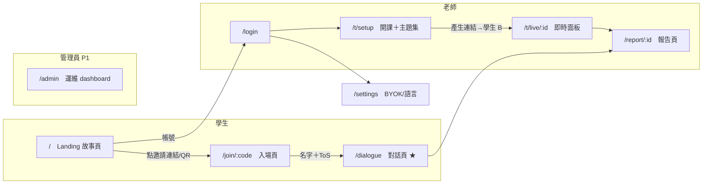

# 前端架構（web-next）

> 日期：2026-11-05 ｜ 分支：`experiment/web-next` ｜ 狀態：定案
> 前端 SSOT：頁面集合、route map、stack、契約層。功能存在性見 `feature.md`，產品定義見 spec v3（Outline）。

## 1. 產品形態

- 登入後只有一個 LLM 聊天介面：無導覽、無表單、無大量文字
- 語音為主、文字並行
- 學生零配置：名字唯一必填；ToS 勾選屬入場流程
- v3 已裁撤的頁面（側邊欄／題庫／教室社群／四階段活動／上傳／教室探索／音效）不重建

## 2. Route map（8 頁＋1 個 P1）



| #   | Route         | 頁面                 | 誰用                 | 畫面上只有                                                                            | 對應               |
| --- | ------------- | -------------------- | -------------------- | ------------------------------------------------------------------------------------- | ------------------ |
| 1   | `/`           | Landing／故事頁      | 所有人               | 故事動畫＋進入 CTA                                                                    | #83                |
| 2   | `/join/:code` | 入場頁               | 學生                 | 主題預覽＋名字＋ToS 勾選；帳號註冊（選用）同頁，註冊屬入場流程                        | #66、#70、#67      |
| 3   | `/login`      | 帳號登入             | 老師／回訪者         | email＋密碼。訪客不經此頁                                                             | #67                |
| 4   | `/t/setup`    | 開課（教室＋主題集） | 老師                 | 建教室→主題集三來源（既有／自訂／AI 生成）→連結/QR。零配置可直開                      | #77、#66           |
| 5   | `/dialogue`   | 對話頁 ★             | 學生／單人           | 主題標題＋對話流＋按住說話＋文字框＋頭像；學生登入後唯一畫面，查詢／STT／TTS 內嵌於此 | #68、#69、#76      |
| 6   | `/t/live/:id` | 即時面板             | 老師                 | 每生一列：狀態／輪數／違規標記（WS），需關注者置頂                                    | #73、#101          |
| 7   | `/report/:id` | 報告頁               | 老師＋學生（看自己） | 群體：維度漸展星圖＋分群；單人：論點總結＋六角圖；同頁兩視角、去識別化                | #74、#78、#79、#72 |
| 8   | `/settings`   | 設定                 | 老師／單人           | BYOK key（顯示 last4）＋介面語言。學生 flow 無此入口                                  | #82                |
| 9   | `/admin`      | 運維 dashboard（P1） | 管理員               | provider 健康／水位／停損／違規總覽／封禁                                             | #80                |

Journey：學生 `1→2→5→7`；老師 `1→3→4→6→7`；單人 `1→2（僅主題選擇）→5→7`。

非頁面：查詢（融入對話流，#76）、違規偵測（背景）、ToS 文本管理（admin 一環）、表情（判斷層驅動頭像）。

## 3. Stack（版本 2026-11-04 查證）

| 層           | 選擇                                                           | 查證版本                                                     | 備註                                                                  |
| ------------ | -------------------------------------------------------------- | ------------------------------------------------------------ | --------------------------------------------------------------------- |
| UI framework | React + **React Compiler**                                     | 19.3（19.3.0 2026-09-09）／Compiler 1.0（2025-10-07 stable） | Compiler 自動 memoization；鎖精確版本                                 |
| Build        | **Vite 8**（Rolldown）                                         | 8.0（2026-03-12；Rolldown 1.0 2026-05-07）                   | 單一 Rust bundler；與 `@cloudflare/vite-plugin` 相容                  |
| Router       | **TanStack Router**（file-based）                              | 1.170.46（2026-10-22）                                       | 型別安全 search params（入場碼、報告視角）                            |
| Server state | **TanStack Query**                                             | 5.104.5（2026-10-19）                                        | route loader + `ensureQueryData` 沿用現有模式                         |
| Components   | **Base UI**（`@base-ui/react`）                                | 1.9.0（2026-10-09）                                          | shadcn 預設底層（2026-07 起）；`render` prop 取代 `asChild`           |
| Styling      | Tailwind CSS 4                                                 | 既有                                                         | `@tailwindcss/vite` 已在用                                            |
| API client   | **Hono RPC `hc<RpcApp>`**                                      | hono 4.13.16                                                 | client ~2KB＝typed fetch；見 §4                                       |
| i18n         | 手寫 typed dictionary（`Record<MessageKey,string>`＋`useT()`） | —                                                            | in-place 語言切換（不換頁、保留 React state）已實測；三語編譯期完整性 |
| 動畫         | lottie-web（故事頁既有素材）、three.js（頭像）                 | 既有                                                         | #83 明訂不從頭重做動畫                                                |

資產管線：頭像模型以 gltfpack 壓縮——`npx gltfpack -i public/socrates.glb -o out.glb -cc -kn -vp 16 -vn 16 -vt 16 -vc 16`（7.9MB → 1.8MB，2026-11-05）；`scene.ts` 掛 `MeshoptDecoder` 解壓。每次更新模型後重跑，並驗證 `targetNames`（41 個 viseme／blink／brow morphs）與嘴型動畫存活。

不採用：tRPC（非 REST、client ~12KB）；oRPC（typed SSE／OpenAPI 為優勢，待對外 API 需求再評）；Elysia（Bun-locked，Workers 不可用）；TanStack Start（1.0 於 2026-10-13，SPA＋Hono 對 single-Worker 部署更合）；Paraglide JS 3（官方明文 in-place locale transition preserving React state 屬「評估 runtime 替代品」的形狀——本產品核心互動為對話中切語言，2026-11-05 查證 paraglidejs.com/react）。

## 4. 契約層（前後端溝通）

```
apps/server  export type RpcApp = ReturnType<typeof createApp>    ← 型別唯一來源
packages/shared  zod schema（請求/回應驗證）＋ 報告分析型別
apps/web  hc<RpcApp>("/api") ＋ WS client（ws/protocol.ts 的訊息型別在 server 端定義）
```

- RPC：web 只 `import type`（零 runtime 依賴），契約變更於編譯期反映
- `.d.ts` precompile：server 先編型別宣告供 web 消費（Hono 官方 monorepo 建議，控制 tsc／IDE 推導成本）
- **對話不走 RPC**：WebSocket `/agents/chat/:name`（R7）；訊息型別見 `apps/server/src/ws/protocol.ts`、機制見 [`pi.md`](./pi.md)；客戶端以 `applyImmutable` 套用 chord ops
- Auth：cookie `credentials: "include"`；`Accept-Language`
- Mock：server 端 `LLM_PROVIDER=mock`（faux provider）；web 端手寫 mock 已退役

## 5. 語音路徑（對話頁內建）

- 輸入：能力偵測分流——Web Speech API 原生（支援者），否則 `getUserMedia`／`MediaRecorder` 上傳 → server STT（whisper，#69）
- 輸出：TTS 保證路徑＝server-side（2026-11-04 決策）：預設 server-side，或 client `speechSynthesis` 先試、失敗／無 voice 時 fallback（#68 定案）。依據見 `architecture.md` §1
- 頭像嘴型由 speaking 狀態驅動；表情由判斷層 choice 驅動（#90 後）

## 6. 設計 patterns（2026-11-04 查證）

### 對話頁

- 語音不接管全屏：頭像舞台與文字回應同屏共存（Gemini Live inline 範式；ChatGPT 同年移除獨立語音介面）
- 頭像＝狀態機：listening（微 pulse、追蹤麥克風振幅）／thinking（獨立動畫）／speaking（追蹤 TTS 振幅）；單一 pulse 語法讓 barge-in 可見
- mute 而非 pause（Doubao 數據：56% 採用、次日留存 +2.23%）；打斷需明示（tap to interrupt）
- STT interim transcript 顯示於 composer 上方半透明預覽，定稿轉為訊息
- streaming 紀律：不逐 token 動畫；caret hard blink（`steps(2)`）；shimmer 僅限狀態行；`aria-busy`＋句批次 `aria-live`；上捲釋放 auto-scroll
- 空狀態：開場題大字置中＋prompt 按鈕（非純文字，NN/g 2026）
- CJK 排版：行高 ≥1.7；中英混排微調拉丁字比例（Typotheque）

### 教師面板

- Student grid：一生一卡（status pill／struggling flag／最新發言摘要），例外置頂
- Flag 用 amber（非紅）＋icon 並用——非懲罰性；3 秒 glanceable
- Activity feed 側欄與 grid 互補（monitor → notice → decide → act 循環）

### 組件與 motion

- 起底：shadcn chat primitives（MessageScroller／Message／Bubble，2026-06）或 assistant-ui primitives；AI Elements 於 2026-11 併入 shadcn，不基於它新建
- Motion 預算＝單次 message entrance＋caret＋頭像持續動畫，此外不加；全面 `prefers-reduced-motion`；View Transitions（92.9% 支援）不用於 LCP 敏感路由

### 避免

全屏語音接管、逐 token 動畫、spinner 當思考狀態、強制 pin 底部、pause 按鈕、AI 同質化樣板（紫漸層／灰卡堆疊）、CJK 行高 <1.7、紅色大面積 flag、硬 sidebar、空首屏（logo＋textbox）。
