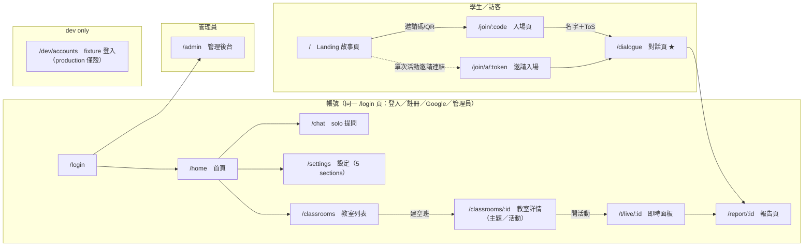

# 前端架構（web-next）

> 日期：2026-11-05 ｜ 更新：2026-11-19（PR #155 整合現況）｜ 分支：`integration/web-next-142`（HEAD `09caede`）｜ 狀態：整合分支已定案、尚未合併——本文件描述整合分支現況，非 production
> 前端 SSOT：頁面集合、route map、stack、契約層。功能存在性見 `feature.md`，API 契約見 `api-contract.md`。

## 1. 產品形態

- AppShell icon rail：首頁、提問（solo，`/chat`）固定；成員另見「學習」（教室）入口，教師模式再加「教室」（teacher view）入口；學生另有設定入口；admin 有「管理」切換
- 語音為主、文字並行
- 入場 guest-first：帳號非必要；登入／註冊／Google OAuth／管理員進入全在 `/login` 同一頁；名字＋ToS 勾選屬入場流程（login-first 反轉不收）
- 帳號模型（user⇄teacher 能力、student 受管帳號、guest accountless）的 SSOT 是 [`accounts.md`](./accounts.md)
- v3 已裁撤不重建：側邊欄、題庫、四階段活動、上傳、教室探索、音效（教室社群已以教室詳情頁分頁形式存在，去留待 #168）

## 2. Route map（13 頁＋1 個 dev route）



| #   | Route                    | 頁面              | 誰用                                     | 畫面上只有                                                                                                                                                     | 對應               |
| --- | ------------------------ | ----------------- | ---------------------------------------- | -------------------------------------------------------------------------------------------------------------------------------------------------------------- | ------------------ |
| 1   | `/`                      | Landing／故事頁   | 所有人                                   | 捲動式漫畫故事（可互動分格）＋進入 CTA                                                                                                                         | #83                |
| 2   | `/login`                 | 帳號頁            | 老師／回訪者（訪客不經此頁）             | 登入＋註冊＋Google OAuth（未設定時按鈕停用）＋邀請碼箱同一頁；admin 登入後進 `/admin`                                                                          | #67                |
| 3   | `/join/:code`            | 入場頁            | 學生／訪客                               | 帳號 vs 訪客加入的選擇＋名字＋ToS 勾選；`?draft=` 續用草稿                                                                                                     | #66、#70、#67      |
| 4   | `/join/a/:token`         | 邀請連結入場      | 學生／訪客                               | 單次活動邀請（token 為 path param）：invite 資訊＋（無帳號時）名字＋ToS                                                                                        | —                  |
| 5   | `/home`                  | 首頁              | 帳號（rail）                             | greeting＋solo 對話統計＋最近對話＋建議                                                                                                                        | PR #108            |
| 6   | `/classrooms`            | 教室列表          | 帳號（rail）                             | 我的教室（`GET /classrooms`，`?view=teacher\|student`）＋加入教室的邀請碼箱；teacher view 有「建立」→ 建空班進詳情                                             | PR #108            |
| 7   | `/classrooms/:id`        | 教室詳情          | 成員                                     | 主題（`TopicPicker`／`AddTopic`：自訂／AI 生成）＋活動（開活動→`/t/live`、測試模式）＋成員＋公告／討論區（社群）＋share code／QR＋單次活動邀請卡＋學生視角預覽 | PR #108            |
| 8   | `/chat`・`/chat/:chatId` | solo 提問（rail） | 帳號成員（guest／student 導回教室）      | `SoloSidebar`（day-bucket 列表、重新命名／刪除／搜尋）＋`DialogueView`（新對話含 `SocratesWindow`）                                                            | —                  |
| 9   | `/dialogue`              | 對話頁 ★          | 學生／訪客／測試 slot                    | 主題標題＋對話流＋按住說話＋文字框＋頭像（`DialogueView`：頭像側欄可收合）；查詢／STT／TTS 內嵌；search：`activityId`／`slot`（測試對話）／`q`／`term`         | #68、#69、#76      |
| 10  | `/t/live/:id`            | 即時面板          | 老師                                     | 5 秒輪詢（#73）：學生狀態、輪數、違規標記、最後一句；結束活動；測試活動顯示「測試對話」面板（slot 增減、開啟各條對話）                                         | #73、#101、#134    |
| 11  | `/report/:id`            | 報告頁            | 老師＋學生（看自己）                     | 群體：維度漸展星圖＋分群；單人：論點總結＋六角圖；同頁兩視角、去識別化                                                                                         | #74、#78、#79、#72 |
| 12  | `/settings`              | 設定              | 帳號（學生可進；accountless 訪客不能進） | 五個 section：general／dialogue／teacher／keys／usage；student 只見 general＋dialogue（無 `/me` 的訪客被導回 `/home`）                                         | —                  |
| 13  | `/admin`                 | 管理後台          | 管理員                                   | tabs：overview／users／requests／schools／notify                                                                                                               | #80                |
| 14  | `/dev/accounts`          | dev fixture 登入  | 開發                                     | fixture 帳號一鍵登入；API dev-gated——production 回 404，頁面只剩「不可用」殼                                                                                   | —                  |

Journey：學生 `1→3（或 4）→9→11`；老師 `1→2→6→7（挑題、開活動）→10→11`；solo 提問 `8`；回訪：session cookie 30 天——關掉瀏覽器後從 `/home`、`/classrooms` 或 `/chat` 回到進行中的活動。

非頁面：查詢（融入對話流，#76）、順帶一問（`BtwPanel` 右側欄，與查詢面板互斥；`useBtw` 另開一條 WS 綁 side session，session id＋fork 點存 sessionStorage 供重整後接回，#121）、違規偵測（背景）、表情（判斷層驅動頭像）。

## 3. Stack（選型查證 2026-11-04；「現況」為 lockfile 安裝版本 2026-11-19，非重新對外查證）

| 層           | 選擇                                                                 | 查證版本                                                     | 現況（lock）                                                                                                      | 備註                                                                  |
| ------------ | -------------------------------------------------------------------- | ------------------------------------------------------------ | ----------------------------------------------------------------------------------------------------------------- | --------------------------------------------------------------------- |
| UI framework | React + **React Compiler**                                           | 19.3（19.3.0 2026-09-09）／Compiler 1.0（2025-10-07 stable） | react 19.3.1；Compiler 由 `@vitejs/plugin-react` 的 `react({ compiler: true })`＋oxc（`oxc-transform-react`）啟用 | Compiler 自動 memoization；鎖精確版本                                 |
| Build        | **Vite 8**（Rolldown）                                               | 8.0（2026-03-12；Rolldown 1.0 2026-05-07）                   | vite 8.3.5＋`@cloudflare/vite-plugin` 2.0.0-beta.v.9                                                              | 單一 Rust bundler；與 `@cloudflare/vite-plugin` 相容                  |
| Router       | **TanStack Router**（file-based）                                    | 1.170.46（2026-10-22）                                       | 1.170.46                                                                                                          | 型別安全 search params（入場碼、報告視角）                            |
| Server state | **TanStack Query**                                                   | 5.104.5（2026-10-19）                                        | 5.105.1                                                                                                           | route loader + `ensureQueryData` 沿用現有模式                         |
| Components   | 手寫 primitives（`components/ui.tsx`，cva＋tailwind-merge）          | —                                                            | —                                                                                                                 | 無第三方元件庫依賴；shadcn 目錄已隨 v3 退役                           |
| Styling      | Tailwind CSS 4                                                       | 既有                                                         | 4.3.3                                                                                                             | `@tailwindcss/vite` 已在用                                            |
| API client   | **Hono RPC `hc<RpcApp>`**                                            | hono 4.13.16                                                 | hono 4.13.16                                                                                                      | client ~2KB＝typed fetch；見 §4                                       |
| i18n         | 手寫 typed dictionary（`Record<MessageKey,string>`＋`useT()`）       | —                                                            | —                                                                                                                 | in-place 語言切換（不換頁、保留 React state）已實測；三語編譯期完整性 |
| 動畫         | 預先算好的 WebP sprite sheet＋`<canvas>`（故事頁）、three.js（頭像） | 既有                                                         | three 0.187.0                                                                                                     | 故事頁不跑即時 3D，手機也順；素材在 `public/story/`                   |
| 工具鏈       | TypeScript／Biome                                                    | —                                                            | typescript 7.0.2／`@biomejs/biome` 2.6.8                                                                          | Biome `useReactCompiler` 把關 render purity（§6）                     |

engines：Node ≥26.12、pnpm ≥12。

資產管線：頭像模型以 gltfpack 壓縮——`npx gltfpack -i public/socrates.glb -o out.glb -cc -kn -vp 16 -vn 16 -vt 16 -vc 16`（7.9MB → 1.8MB，2026-11-05）；`scene.ts` 掛 `MeshoptDecoder` 解壓。每次更新模型後重跑，並驗證 `targetNames`（41 個 viseme／blink／brow morphs）與嘴型動畫存活。

不採用：tRPC（非 REST、client ~12KB）；oRPC（typed SSE／OpenAPI 為優勢，待對外 API 需求再評）；Elysia（Bun-locked，Workers 不可用）；TanStack Start（1.0 於 2026-10-13，SPA＋Hono 對 single-Worker 部署更合）；Paraglide JS 3（官方明文 in-place locale transition preserving React state 屬「評估 runtime 替代品」的形狀——本產品核心互動為對話中切語言，2026-11-05 查證 paraglidejs.com/react）。

## 4. 契約層（前後端溝通）

```
apps/server  export type RpcApp = ReturnType<typeof createApp>    ← 型別唯一來源
packages/shared  zod schema（請求/回應驗證）＋ 報告分析型別
apps/web  hc<RpcApp>("/api") ＋ WS client（ws/protocol.ts 的訊息型別在 server 端定義）
```

- RPC：web 只 `import type`（零 runtime 依賴），契約變更於編譯期反映
- `.d.ts` precompile：server 先編型別宣告供 web 消費（Hono 官方 monorepo 建議，控制 tsc／IDE 推導成本）
- **對話不走 RPC**：WebSocket `/agents/chat/:name`（R7）；訊息型別見 `apps/server/src/ws/protocol.ts`、機制見 [`pi.md`](./pi.md)；客戶端以 `applyImmutable` 套用 chord ops
- Auth：`socrates_session`（帳號 HMAC session，30 天）與 `socrates_participant`（accountless 訪客參與者，7 天）兩枚 cookie，`credentials: "include"`；`Accept-Language`。帳號／訪客／role 語義的 SSOT 是 [`accounts.md`](./accounts.md)
- Mock：server 端 `LLM_PROVIDER=mock`（faux provider）；web 端手寫 mock 已退役

## 5. 語音路徑（對話頁內建）

- 輸入：能力偵測分流——有 Web Speech API（`SpeechRecognition`）→ 辨識的 final 結果直接作為輸入送出；否則 `getUserMedia`＋`MediaRecorder` 錄音上傳 → server STT（whisper，`POST /api/stt`，#69）
- 輸出：TTS 保證路徑＝server-side（2026-11-04 決策）：預設 server-side，或 client `speechSynthesis` 先試、失敗／無 voice 時 fallback（#68 定案）。依據見 `architecture.md` §1
- 頭像嘴型由 speaking 狀態驅動；表情由判斷層 choice 驅動（#90 後）

## 6. 設計 patterns（2026-11-04 查證）

### 對話頁

- 語音不接管全屏：頭像舞台與文字回應同屏共存（Gemini Live inline 範式；ChatGPT 同年移除獨立語音介面）
- 頭像＝狀態機：listening（微 pulse、追蹤麥克風振幅）／thinking（獨立動畫）／speaking（追蹤 TTS 振幅）；單一 pulse 語法讓 barge-in 可見
- mute 而非 pause（Doubao 數據：56% 採用、次日留存 +2.23%）；打斷需明示（tap to interrupt）
- STT interim transcript 顯示於 composer 上方半透明預覽，定稿轉為訊息
- streaming 紀律：不逐 token 動畫；caret hard blink（`steps(2)`）；shimmer 僅限狀態行；`aria-busy`＋句批次 `aria-live`；上捲釋放 auto-scroll
- 空狀態：開場題大字置中＋prompt 按鈕（非純文字，NN/g 2026）
- CJK 排版：行高 ≥1.7；中英混排微調拉丁字比例（Typotheque）

### 教師面板

- Student grid：一生一卡（status pill／struggling flag／最新發言摘要），例外置頂
- Flag 用 amber（非紅）＋icon 並用——非懲罰性；3 秒 glanceable
- Activity feed 側欄與 grid 互補（monitor → notice → decide → act 循環）

### 組件與 motion

- 對話流為手寫元件（`DialogueView`／`Turn`）；shadcn chat primitives／assistant-ui 曾評估、未落地，AI Elements 不基於它新建
- Motion 預算＝單次 message entrance＋caret＋頭像持續動畫，此外不加；全面 `prefers-reduced-motion`；View Transitions（92.9% 支援）不用於 LCP 敏感路由

### 資料流（effect-free）

`useEffect` 全面禁止（Biome `style/noRestrictedImports`＋`apps/web/AGENTS.md`，2026-11-18 清零 38 條 compiler 診斷）：事件／DOM／媒體查詢／時鐘訂閱一律走 `src/hooks/useSubscription.ts`（`useDomEvent`／`useOnUnmount`／`useMediaQuery`／`useElapsed`／`useNow`，`useSyncExternalStore` 實作）；latest callback 於 commit 後同步、render 不讀 impure 值。動畫用的 rAF 共用 module-scope frame loop（`lib/frameLoop.ts` 的 `createFrameLoop`：landing 故事、`SocratesCompanion`、`DotField`、`StoaField`）；例外：`useVoiceInput` 的麥克風 meter 按錄音 session 生命週期自帶 rAF loop，不共用。Biome 2.6.8 `useReactCompiler` 持續把關 render purity。

### 避免

全屏語音接管、逐 token 動畫、spinner 當思考狀態、強制 pin 底部、pause 按鈕、AI 同質化樣板（紫漸層／灰卡堆疊）、CJK 行高 <1.7、紅色大面積 flag、硬 sidebar、空首屏（logo＋textbox）。
