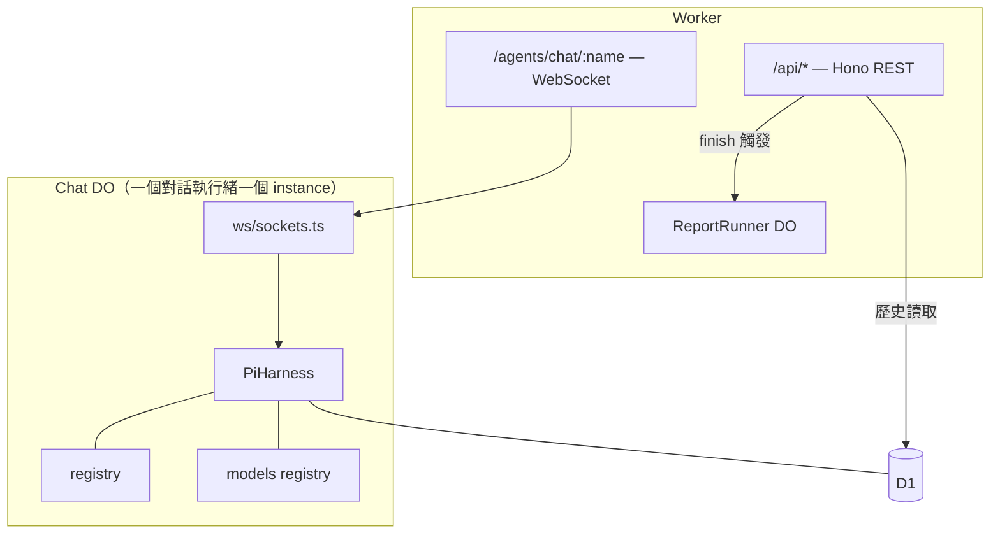

# Pi Durable（PiHarness）參考

本專案的對話引擎。pi 負責 agent 迴圈的一切：transcript、input admission、模型呼叫、工具、重試、崩潰恢復。我們只寫 transport glue 與政策（extensions、gateway）。

上游：pi（https://pi.dev）由 Earendil 開發；Durable Object 宿主由 Cloudflare Agents SDK 提供（`agents/harness/pi`）。查證日期 2026-11-06（pi 1.5.0 / agents 0.33.0，以 node_modules 原始碼為準）。

## 版本配對鎖

`agents` 每個版本只對應一個 pi minor。本專案錨定 `agents ^0.33.0` 與 `@earendil-works/pi-durable` / `pi-ai` / `chord` / `pi-schema` `~1.5.0`。

- pi-durable 是 experimental，minor 升級可能改 API
- 儲存格式跨 minor 不相容：pi 1.5 寫入的 conversation，退回 1.4 的 Worker 讀不了。升級是單向門，出錯只能 roll forward
- 升級時 `agents` 與 `@earendil-works/pi-*` 必須一起評估

## 兩大原則

1. **pi handles everything**。agent 語意全在 pi-durable；寫 server 邏輯前先查 `node_modules/@earendil-works/pi-durable/dist/harness/types.d.ts`，不憑記憶。
2. **everything is an extension**。行為全在 extension（prompts / tools / hooks / tasks），裝在 registry。DO 只負責 host 與 install，transport 只搬運 view。

細節規範在 `apps/server/AGENTS.md`，此處不重複。

## 架構位置



- 一個對話執行緒是一個 Chat DO instance；root session id 為 `"1"`（`ROOT_SESSION`）
- pi 的資料在 DO SQLite 的 `pi_*` 表，與 D1 的產品資料分離
- ReportRunner DO 負責報告生成（activity 級，alarm 驅動）

## 兩層 API，不要混淆

實際上有兩層 API，介面相似但不同：

| 層                           | 取得方式                                                                   | 方法                                                                     | 用途                                                                                              |
| ---------------------------- | -------------------------------------------------------------------------- | ------------------------------------------------------------------------ | ------------------------------------------------------------------------------------------------- |
| `PiSession`（agents）        | `harness.session(id)`                                                      | `submit` / `wait` / `watch` / `busy` / `messages` / `setModel` / `abort` | 對話執行緒的日常驅動；`wait` 的結果帶 `text`                                                      |
| `Conversation`（pi-durable） | `harness.createConversation` / `harness.conversation(id)` / `harness.root` | `submit` / `wait` / `watch` / `configure` / `entries` / `commit`         | 建立新 conversation（含 agent profile）；`wait` 的結果**沒有** `text`，最終全文從 answer entry 取 |

`PiOperationResult.text` 只存在於 agents 層；pi-durable 的 `SettledSubmissionRecord` 沒有 text，要從 `conversation.entries({ maxEntryId: settled.answer })` 拿回答。

## 對話的驅動順序

watch 的首個值只含附掛當下的視窗；先 submit 再 `start()` 會漏掉瞬時完成的 run。順序：

```ts
const stream = await session.watch(); // 先拿 watch
stream.start(listener); // 先開始消費
const receipt = await session.submit(text); // 再送出
const result = await session.wait(receipt.operationId);
```

串流內容：首個 `view`（整份 `ConversationView`），之後每次變更是 chord `ops`。客戶端用 `applyImmutable`（`@earendil-works/chord/delta`）套用；不要自己寫 delta applier——chord 的 op 語意比直覺複雜，我們踩過。

in-flight 回覆的累計全文在 `view.docs["pi.live"].generation.message`。

### no queue

submit 一律帶 `whenBusy: "reject"`：run 進行中第二發被 `ConversationBusy` 拒絕，不排隊。這是產品決定（#110）。

### 重連

watch 沒有 event cursor；重連以 `watch({ from: newestEntryId + 1 })` 讓 window 從客戶端已有的最新 entry 之後開始。這是官方設計（pi 的 NOTES.md：「Events have no cursor」）。

## Extensions

行為的唯一載體。官方支援三種形狀（pi.dev/docs/latest/extensions）：單檔 `extensions/<name>.ts`（小）、目錄 `extensions/<name>/index.ts`（多檔）、`package.json` 的 `pi.extensions` manifest（帶 npm 依賴）。

本專案已裝：

- `socrates`（單檔）：preamble section，內容為 `apps/server/src/prompts/socrates.md`
- `avatar`（目錄，#111）：afterRun hook → Clef choice 題 → 寫 `app.emotion` entry（`{emotion, probabilities, confidence}`）
- `judgment`（目錄，#71）：afterRun 分類 task＋`report_violation` tool → 寫 `app.violation` entry
- `websearch`（目錄，#112）：`web_search` / `fetch_content` / `get_search_content` 三 tool（形制參考 pi-web-access，裁剪至 Workers 環境）

寫 extension 的要點：

- custom entry 用 `defineEntry("app.xxx")`：不進 model context，隨 transcript 與 view 流動。情緒與違規走這個，不污染對話文字
- afterRun hook 拿到的 `HookApi` **沒有 `commit`**；要寫 entry 就回 `runEndTask(Task, input)`，在 task phase 的 `runtime.commit` 裡寫。task 由 pi 管理，crash 後恢復，`runtime.memo()` 做冪等
- tool 用 `defineTool` + `pi-schema`（`obj` / `str` / `oneOf`）；`replay: "safe"` 的 tool 在 crash 後會重跑，其他回中斷結果

## Agent profile

每個 conversation 自帶 `AgentState`：`model` / `extensions` / `tools` / `instructions` / `maxTurns`。`createConversation` / `fork` / `root` 都接受 `agent: AgentChange`。

本專案的四個 profile（`pi/agents/profiles.ts`）：

- `socrates`：學生對話（root），extensions 全開
- `lookup`（#76）：查詢，websearch tools，maxTurns 3
- `topic-gen`（#77）：出題，websearch tools，maxTurns 6
- `report-analyst`（#74）：報告，無 tool，maxTurns 4

準則：功能升格為 agent（有工具迴圈或長任務）；單發的分類（violation / 情緒）用 oneshot。profile 不寫 model——model 由 gateway 依 traffic class 解析（`apps/server/providers.config.yaml`，#98）。

驅動（`runProfile`）：`router.pick(trafficClass)` → `conversation.configure({ model })` → `submit` → `wait` → 從 answer entry 取文。models 與 registry 由呼叫端傳入，必須與 harness 同一實例——registry 訂閱與 faux 狀態都是 per-instance，另建一份拿不到（踩過）。

## Fallback legs

`createAI` 的 model options 原生支援 fallback 鏈：

```ts
const model = ai(head, { fallback: [leg1, leg2] });
```

行為（`agents/dist/models/pi-ai/models/fallback.js` 源碼）：

- legs 陣列無上限，依序嘗試
- leg 在**吐出任何內容之前**以 error 結束 → 換下一 leg；已吐內容 → committed，之後的 error 直接往上拋（不重複輸出）
- `start` / `text_start` 等只宣告不帶內容的事件不算產出（held back），換腿乾淨
- 被放棄的 legs 記錄在回答的 `cloudflare-fallback` diagnostic

綁定機制（本專案實證）：options 存在 model object 的 `MODEL_OPTIONS` symbol。pi generation 經 `Models.getModel(ref)` 取得 provider catalog 的原物件（引用，非拷貝），symbol 保留，provider 層的 `streamWithFallback` 就會生效。所以 `pi/models.ts` 包裝 provider 的 `getModels`，把鏈首換成帶 legs 的版本。鏈的順序來自 `providers.config.yaml`，程式碼裡沒有模型 id。

## 設定與恢復

`Harness.open` 的 `settings`：`retry: { enabled: true, maxRetries: 5, baseDelayMs: 1000 }`（指數退避 1/2/4/8/16 秒）、`afterFailedRun: "continue"`。

睡覺中的任務靠 `onWake` 喚醒，`PiHarness` 把它接上 DO alarm（`Lifecycle.install(this).use(this.harness)`），物件其他時間可休眠。

恢復：DO 被驅逐或崩潰 → alarm 重啟 → pi 從最後 checkpoint 續跑。模型串流中斷保留已收到的部分，計入 retry。`replay: "safe"` 的 tool 重跑，其他回中斷結果。連續崩潰 `restartLimit`（預設 5）次 → 任務 parked，`onReport` 收到 `task_interrupted`。

孤兒 run（設計決定，#110）：WS 斷線時 run 繼續跑完，回應照樣進 transcript——學生回來看得到完整回答。佔用秒級（回覆 ≤3 句），不取消。

registry 必須是 DO 的 instance field：pi 對 registry 的訂閱持續到 Harness 關閉，而 evicted object 永不關閉，module scope 的 registry 會跨實例洩漏（官方文件明言）。

## 測試

`LLM_PROVIDER=mock` 或無 `AI` binding 時註冊 faux provider：

```ts
const faux = fauxProvider({ tokensPerSecond }); // FAUX_TOKENS_PER_SECOND 控制時序
faux.setResponses([fauxAssistantMessage([fauxText("…")])]);
```

- 斷言只驗形狀（entry kind / 角色 / 非空文字），不驗內容
- faux 的 response factory 裡不能 `require()`——workerd 模組解析失敗，要用頂層 import（踩過）
- responses 耗盡後 faux 回 error（`No more faux responses queued`），測試要設足夠的 responses
- WebSocket 測試用真 DO＋真升級（`routeAgentRequest`）；首幀是 SDK 的 `cf_agent_identity`，斷言用 `frames.some(...)` 而非 `frames[0]`
- eviction 測試：`evictDurableObject(stub)`，傳 stub 而非 `(namespace, id)`

## 已知限制

| 項目                          | 影響                                                                                                                                                                                                                                                             |
| ----------------------------- | ---------------------------------------------------------------------------------------------------------------------------------------------------------------------------------------------------------------------------------------------------------------- |
| watch 無 event cursor         | 重連靠 `from`（window 起點），官方設計                                                                                                                                                                                                                           |
| 自訂 doc 不 mount `view.docs` | view 只 mount 內建 doc（`MOUNTED` 列表寫死）；自訂狀態走 custom entry，或 `harness.watchDoc`（per-address watch）                                                                                                                                                |
| doc / commit 不跨 DO          | `Session` 綁 storage，`observeCommits` 只見本 DO 的 conversation——跨 DO 聚合（例如老師面板）不能靠 pi doc（#73 調查）                                                                                                                                            |
| 儲存格式跨 minor 不相容       | 升級單向門                                                                                                                                                                                                                                                       |
| DNS rebinding 殘餘            | websearch 的 SSRF 防護在 URL 層（WHATWG 正規化＋私網/協定/NAT64 檢查）；Workers 無 DNS pre-resolution hook，故依賴：search-hit 閘門（只能 fetch 本對話搜過的 URL）＋redirect 目的地須同站或也是 search hit＋Workers egress 隔離。開放任意 URL 抓取前必須重新評估 |
| 同一學生多分頁                | 兩分頁共用同一 Chat DO：另一分頁 run 失敗的 id-less 廣播會清掉本分頁 pending（單分頁是主流情境，接受）                                                                                                                                                           |

## 來源

- Pi harness（Agents SDK）：https://developers.cloudflare.com/agents/harnesses/pi/
- Models for pi-ai（fallback / byokAlias / sessionAffinity）：https://developers.cloudflare.com/ai-gateway/integrations/pi-ai/
- Extensions / Packages：https://pi.dev/docs/latest/extensions 、 https://pi.dev/docs/latest/packages
- pi-durable README（hooks / tasks / docs 的權威）：https://github.com/earendil-works/pi/tree/main/packages/durable
- pi-ai README（providers / classify / cross-provider handoffs）：https://github.com/earendil-works/pi/tree/main/packages/ai
- 官方範例（sockets / view / mirror 模式）：https://github.com/cloudflare/agents/tree/main/examples/next/harnesses/pi
- pi-router / pi-fallback-provider（gateway 參考）：https://pi.dev/packages/pi-router 、 https://pi.dev/packages/pi-fallback-provider
